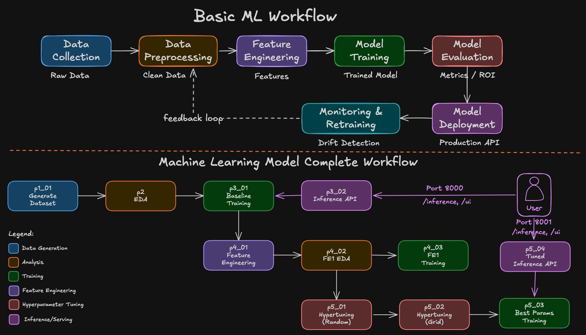

# 00 - Introduction

This section has three short parts: a welcome video that introduces the whole course (the finished project first, then the plan, the tools, who it is for, and where the code is), an article with the links to the code and the website, and a 1 to 2 minute Important Notes video.

## Table of Contents

| Step | Topic |
|------|-------|
| Step-01 | [Welcome: What You Will Build](#step-01-welcome-what-you-will-build) |
| Step-02 | [Important Notes](#step-02-important-notes) |

---

## Step-01: Welcome: What You Will Build

![Course at a glance: Machine Learning End-to-End: Credit Card Fraud Detection. Build a real fraud model in Python, from raw data to your own FastAPI inference API. 15 hours of video, 92 lectures, 10 sections and 2 FastAPI APIs. Made for DevOps, SRE and cloud engineers moving into machine learning, and also for MLOps and AIOps engineers, developers, data engineers and students, and Python learners. Tech stack: plain Python scripts, not notebooks, with Python, pandas, NumPy, scikit-learn, Matplotlib, Seaborn, FastAPI, Pydantic, Uvicorn, Miniconda and VS Code. One project, built section by section: 00 Introduction, 01 ML Fundamentals, 02 Python Setup, 03 Synthetic Dataset and 04 A Model Training, then 04 B Inference API, 05 Data Analysis (EDA), 06 Feature Engineering, 07 Hyperparameter Tuning and 08 Tuned Inference API. Up next: the MLOps series on AWS, Azure, GCP and open source, and this course is the foundation](../images/00-00-02-CourseAtAGlance.png)

You build one complete machine learning project in Python: a credit card fraud detector, from raw data to your own prediction API. It is plain Python scripts, not notebooks, organized the way real projects are.


### See the End Result First

By the end of the course you have two prediction APIs running on your own computer, each with a small web page:

- the **baseline API** (Section 04 B, port 8000), with the first model we build;
- the **tuned API** (Section 08, port 8001), with the final model, after feature engineering and tuning.

Here both get the same real transaction from our test data: $363.26 at a gas station, card not present, more than twice this customer's usual amount. We know the true answer: it was fraud.

![The intro demo page, Credit Card Fraud Detection: Baseline vs Tuned, with the two course web pages side by side, the baseline ML model on port 8000 and the final tuned ML model on port 8001, on test row 7382, a 363 dollar gas station purchase that was really fraud, loaded with the Real Fraud from Test Data button: the baseline says LEGITIMATE with 38.7 percent fraud probability, the tuned model says FRAUD, high risk, with 67.3 percent. Below them, the Net Benefit before tuning is 39,625 dollars and after tuning 50,550 dollars, a gain of 10,925 dollars](../images/00-01-05-BaselineVsTunedDemo.png)

| Transaction | True answer | Baseline API (port 8000) | Tuned API (port 8001) |
|---|---|---|---|
| Test row 7382: $363.26 gas station, card not present | Fraud | LEGITIMATE, 38.7% (lets it through) | **FRAUD, 67.3% (catches it)** |
| The page's Fraud Example: $2,500 of electronics at 2 AM, from another country | (a made-up example) | FRAUD, 99.7% | FRAUD, 99.8% |

On an obvious fraud, both models agree. The difference is in the harder cases, and over the 2,000 test transactions that difference is worth thousands of dollars. Getting from the left model to the right one, and proving it in dollars, is what this course is about.

Each API also has a `/docs` page, so any program can call it, not just the web page. You run both APIs yourself in Section 08. To run this whole demo right now, use the [intro-demo-scripts](intro-demo-scripts/) folder: one script creates both models, starts both APIs and opens this side-by-side page. Your exact numbers may differ a little from these (see [Important Notes](Important-Notes.md)).

### The Machine Learning Workflow

Most machine learning projects follow these seven stages, and Section 01 covers each one. Stages 1 to 6 are the core machine learning job, and this course builds all of them. In stage 6 we put the model behind an API; running that API on infrastructure (Docker, Kubernetes, cloud) is MLOps work. Stage 7, monitoring and retraining, is MLOps too: monitoring feeds fresh data back in, and the model is retrained. Section 01 explains both, but we do not build them.

![The machine learning workflow in seven stages. Stages 1 to 6 are core machine learning, built in this course: data collection, data preprocessing, feature engineering, model training, model evaluation, and model deployment, which here means the API only, no infrastructure. Stage 7, monitoring and retraining, is MLOps: explained, not built. A feedback loop goes from stage 7 back to data preprocessing: monitoring feeds fresh data back in, and the model is retrained. Why we stop at stage 6: stage 7 is MLOps, the next layer after the core machine learning job. Running the API on infrastructure (Docker, Kubernetes, cloud) and monitoring it need other tools. Section 01 explains them, but we do not build them](../images/00-03-01-MLWorkflow.png)

### A Quick Note Before We Continue

The rest of this introduction gives you the whole plan: the course map, how our scripts follow the workflow, the tools, the journey in dollars, who the course is for, and where the code lives. Many students like to see all of this before they start; you choose your path. If you would rather start right away, go to the next lecture, then Section 01, Machine Learning Fundamentals.

![A quick note before we continue, as a flowchart. Seen so far: the intro start, the CCFD project demo, and the ML workflow with 7 stages. You are here: many students like to see the whole plan before they start, so you choose your path. Keep watching, 15 more minutes, so your 15 hours are well spent: the course map, how our project follows the workflow, the whole project in one picture, the tools you will use, the journey in dollars, who this course is for, and your course repo and website, then the intro ends. Or, ready to start mastering ML? Skip and move to the next lecture; up next is Section 01, ML Fundamentals, with what is artificial intelligence, the ML workflow with all 7 stages one by one, and the ML workflow versus the CCFD project workflow](../images/00-01-08-LearnAtYourOwnPace.png)

### The Course Map

The course has ten sections, and every section adds one piece to the same project:


### How Our Project Follows the Workflow

In our project, each machine learning stage is a Python script, and each section builds one of them:


| Step | Script(s) | Section |
|---|---|---|
| Data | `p1_01_generate_initial_dataset.py` | 03 |
| Train + evaluate (baseline) | `p3_01_train_model_baseline.py` | 04 A |
| Serve (baseline API) | `p3_02_inference_api_baseline.py` + `p3_03` test | 04 B |
| Explore (EDA) | `p2_eda_base.py` + auto-EDA tools | 05 |
| Feature engineering | `p4_01` / `p4_02` / `p4_03` | 06 |
| Hyperparameter tuning + tuned model | `p5_01` / `p5_02` / `p5_03` | 07 |
| Serve (tuned API) | `p5_04_inference_api.py` + `p5_05` test | 08 |

We build a working baseline first (Section 04), then come back to explore and improve it.

### The Whole Project in One Picture

Here is everything together, in one picture. Read it in three parts.



1. **The top row: the general machine learning workflow.** These are the stages most machine learning projects go through, from collecting the data to serving the model, with a feedback loop back to data preprocessing.
2. **The second row: what we build in this course, at a single glance.** Each box is one Python script of our project, from generating the data to the two APIs on ports 8000 and 8001. Don't worry about the names yet: Section 01 walks through this map box by box. (The picture draws EDA before the baseline. In the course we build and serve the baseline first, then come back and explore the data, as the map above shows.)
3. **Monitoring, drift detection and retraining: explained, not built.** In the top row they come after the model goes live. Section 01 explains them, but we do not build them in this course. Here is why:

    - **3.1. It is MLOps work, not the core machine learning job.** The core job of a machine learning engineer is what this course teaches end to end: get the data, train the model, judge it by the money it saves, improve and tune it, and serve it behind an API. Running monitoring and retraining in production is the next layer, MLOps, and it only makes sense once you can build the model itself.
    - **3.2. A makeshift version is not worth your time.** Real teams use dedicated tools for this (for example MLflow, Evidently, Prometheus and Grafana, with a scheduler and a model registry), and that is a whole topic of its own.

### The Tools You Will Use

![The tools you will use, in six groups. Setup in Section 02: Python 3.14, Miniconda and pip, one main environment mlops-env1 installed from requirements.txt. Data in Section 03: pandas and NumPy generate 10,000 card transactions into a CSV file. Explore in Sections 05 and 06: Matplotlib and Seaborn, plus the optional fg-data-profiling and Sweetviz reports. Machine learning in Sections 04 A, 06 and 07: scikit-learn with Pipeline, LogisticRegression, RandomizedSearchCV and GridSearchCV. Serve as an API in Sections 04 B and 08: FastAPI, Uvicorn and Pydantic, with the inference, health, docs and ui endpoints. Project and code in Sections 03 to 08: Python scripts, not notebooks, with shared utils modules, and models, metrics and settings saved with pickle, JSON and PyYAML. Every tool is explained the first time we use it. Not in this course: Docker, Kubernetes, MLflow and cloud deployment](../images/00-01-06-ToolsYouWillUse.png)

| Group | Tools | Sections |
|---|---|---|
| Setup | Python 3.14, Miniconda, pip (`mlops-env1`, `requirements.txt`) | Section 02 |
| Data | pandas, NumPy | Section 03 |
| Explore (EDA) | Matplotlib, Seaborn; optional: fg-data-profiling, Sweetviz | Sections 05 and 06 |
| Machine learning | scikit-learn (`Pipeline`, `LogisticRegression`, `RandomizedSearchCV`, `GridSearchCV`) | Sections 04 A, 06 and 07 |
| Serve as an API | FastAPI, Uvicorn, Pydantic (`/inference`, `/health`, `/docs`, `/ui`) | Sections 04 B and 08 |
| Project + code | Python scripts, not notebooks; shared `utils/` modules; pickle, JSON, PyYAML | Sections 03 to 08 |

Every tool is explained the first time we use it. Docker, Kubernetes, MLflow and cloud deployment are not part of this course.

### The Journey in Dollars

We judge every change by the money it saves the bank (Net Benefit, measured on the 2,000 test transactions). The baseline API runs the first model on this chart, and the tuned API runs the last one:

![The journey in dollars, as a table with the columns Section, What we do and Net Benefit. Section 04 A: Baseline Model, Logistic Regression on 8 features, 39,625 dollars. Section 06: plus Feature Engineering, one new feature amount_ratio adds only 75 dollars, 39,700 dollars. Section 07: plus Hyperparameter Tuning using Random Search, RandomizedSearchCV over a narrow class_weight grid actually loses 2,675 dollars, 37,025 dollars. Section 07: plus Hyperparameter Tuning using Grid Search, GridSearchCV over a wider, money-weighted class_weight grid catches 57 of 60 test frauds, 50,550 dollars. Net Benefit goes up by about 11,000 dollars over the baseline. Your exact numbers may differ a little by machine; Section 07 explains why](../images/00-01-03-JourneyInDollars.png)

| Section | What we do | Net Benefit |
|---|---|---|
| 04 A | Baseline Model: Logistic Regression on 8 features | $39,625 |
| 06 | + Feature Engineering: one new feature, `amount_ratio` | $39,700 |
| 07 | + Hyperparameter Tuning using Random Search (`RandomizedSearchCV`, narrow `class_weight` grid) | $37,025 |
| 07 | + Hyperparameter Tuning using Grid Search (`GridSearchCV`, wider money-weighted `class_weight` grid) | $50,550 |

### Who This Course Is For

![Who this course is for. Made for: DevOps, SRE, and cloud engineers moving into machine learning; MLOps and AIOps engineers who want the machine learning foundation; developers, data engineers, and students with some Python and no machine learning yet; Python learners ready for their first machine learning project. Before you start: Python basics, no machine learning needed, a Mac, Windows, or Linux computer, free tools and no cloud account. We explain each machine learning idea with our project's own numbers](../images/00-01-04-WhoThisIsFor.png)

- **Made for:** DevOps, SRE, and cloud engineers moving into machine learning; MLOps and AIOps engineers who want the machine learning foundation; developers, data engineers, and students with some Python and no machine learning yet; Python learners ready for their first machine learning project.
- **Before you start:** Python basics. No machine learning needed. A Mac, Windows or Linux computer. Free tools, no cloud account.

### Your Course Repo and Website

This course has two places. The GitHub repository is the primary one: you work there. The website is an add-on, for reference anytime.

![Your course repo and website. On the left, the primary place to start: the Course GitHub Repo at github.com/stacksimplify/mlops-01-ccfd-project, with folders 00 to 08 in course order, a README in each folder that walks you through every step, and each section's code in its own ccfd-project folder; clone or download it once, then run all the code from there. On the right, the add-on for reference anytime: the Course Website at machine-learning-end-to-end.stacksimplify.com, with the same READMEs laid out for easy reading, search across every section, and open it anytime on any device. Footer: work in the repo, and open the website anytime for quick reference](../images/00-01-07-CourseRepoAndWebsite.png)

- **Course GitHub repository (primary, start here):** [github.com/stacksimplify/mlops-01-ccfd-project](https://github.com/stacksimplify/mlops-01-ccfd-project). All the code is here. Each section's code sits in a `ccfd-project/` folder inside its section folder (Section 04 has one per part), and the README in each folder walks you through every step. Clone or download it once, then run all the code from here.
- **Course website (add-on, for reference anytime):** [machine-learning-end-to-end.stacksimplify.com](https://machine-learning-end-to-end.stacksimplify.com/). The same READMEs, laid out for easy reading, with search across every section. Open it anytime, on any device.

**Get the code (one time).** Pick one of the two ways:

- **Download ZIP:** on the repository page, click **Code**, then **Download ZIP**. Unzip it (the folder is called `mlops-01-ccfd-project-main`) and open a terminal in that folder.
- **Clone it with git:**

```bash
git clone https://github.com/stacksimplify/mlops-01-ccfd-project.git
cd mlops-01-ccfd-project
```

Every command in this course runs from that folder (the repository root) or from a section folder inside it.

---

## Step-02: Important Notes

A short video, 1 to 2 minutes, with four notes that save you time:

![Important notes, in four cards. 1, code and website: all the code is in the course GitHub repo, one folder per section, and the website has the same READMEs. 2, your numbers may differ: the videos were recorded on an Intel Mac and the README numbers come from Apple Silicon; Section 07 shows 46,525 dollars on camera and 50,550 dollars in the README, and the story stays the same. 3, not in this course: MLflow, KServe, DVC, Docker, Kubernetes, Prometheus, Grafana or advanced sections mentioned in a lecture. 4, if pip is missing: activate the new conda environment first, then run conda install pip; Section 02 shows the setup step by step. The full notes are on the Important Notes page, in the repo and on the website](../images/00-02-04-ImportantNotes.png)

- **Code and website:** all the code is in the course GitHub repo, and the website has the same READMEs (see "Your Course Repo and Website" above).
- **Your numbers may differ** from the videos (Intel Mac vs Apple Silicon Mac).
- **MLflow, KServe, other MLOps tools and "advanced sections"** mentioned in some lectures are not part of this course.
- **If `pip` is missing** in a new conda environment: activate it, then run `conda install pip`.

Read the full notes: [Important Notes](Important-Notes.md)

Next: [01 - Machine Learning Fundamentals](../01_ML_Fundamentals/)
