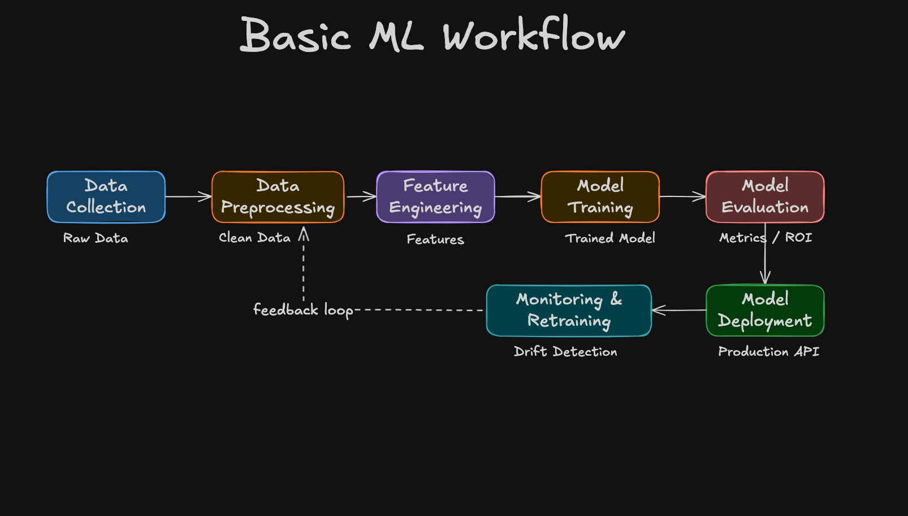
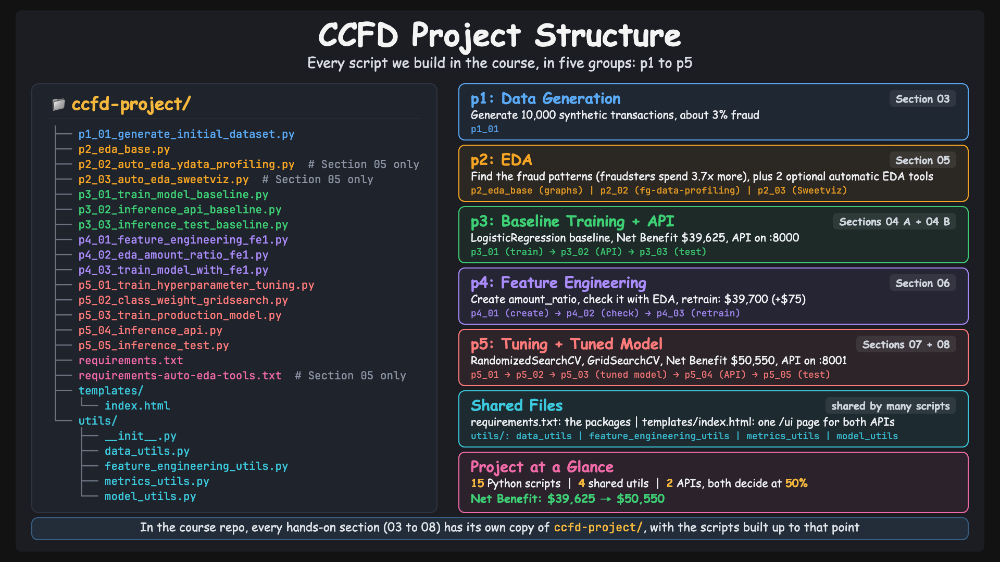

# 01 - Machine Learning Fundamentals

Before writing any code, let's build a shared vocabulary: what AI and machine learning are, what our fraud detection project is, and every stage of the machine learning workflow.

## Table of Contents

| Step | Topic |
|------|-------|
| Step-00 | [Theory Note](#step-00-theory-note) |
| Step-01 | [What is Artificial Intelligence?](#step-01-what-is-artificial-intelligence) |
| Step-02 | [CCFD Project Introduction](#step-02-ccfd-project-introduction) (reading, no video) |
| Step-03 | [ML Workflow: Data Collection and Data Preprocessing](#step-03-ml-workflow-data-collection-and-data-preprocessing) |
| Step-04 | [ML Workflow: Feature Engineering](#step-04-ml-workflow-feature-engineering) |
| Step-05 | [ML Workflow: Model Training](#step-05-ml-workflow-model-training) |
| Step-06 | [ML Workflow: Model Evaluation](#step-06-ml-workflow-model-evaluation) |
| Step-07 | [ML Workflow: Model Deployment](#step-07-ml-workflow-model-deployment) |
| Step-08 | [ML Workflow: Model Monitoring and Retraining](#step-08-ml-workflow-model-monitoring-and-retraining) |
| Step-09 | [ML Workflow vs CCFD Project Workflow, and the Project Structure](#step-09-ml-workflow-vs-ccfd-project-workflow-and-the-project-structure) |

---

## Step-00: Theory Note

This section is theory: no terminal and no code, just diagrams. Every idea here comes back later, when the workflow stages become the scripts we build in Sections 03 to 08.

![Section 01, theory first: a heads-up before we start. The videos of Section 01 with their minutes: 01 What is Artificial Intelligence?, 13 min; 02 ML Workflow: Data Collection and Data Preprocessing, 10 min; 03 ML Workflow: Feature Engineering, 6 min; 04 ML Workflow: Model Training, 6 min; 05 ML Workflow: Model Evaluation, 4 min; 06 ML Workflow: Model Deployment, 7 min; 07 ML Workflow: Model Monitoring and Retraining, 8 min; 08 ML Workflow vs CCFD Project Workflow, and the Project Structure, 16 min; 8 videos, all theory, about 71 min. Heads-up: this section is theory, no terminal and no code yet, just diagrams, and it can feel slow. Please do not skip it: it is the map for the whole course, and every stage you learn here becomes a script we build in Sections 03 to 08; strongly recommended. Tip: watch at your own speed, one or two videos at a time, and come back to them when a later section uses an idea. About 71 minutes of ideas, then Section 02 sets up Python and we start building](../images/01-00-00-TheoryNote.png)

---

## Step-01: What is Artificial Intelligence?

AI, machine learning, deep learning and generative AI fit inside each other like nested boxes, and every level follows the same pattern: input, processing, output.

- **Artificial intelligence:** machines that mimic human intelligence. Humans write the rules, and a decision engine turns them into an action (email filters, chess engines, navigation).
- **Machine learning:** structured data goes into a training algorithm (for example logistic regression), and the result is a model that makes predictions. Nobody writes the rules: the data teaches the model.
- **Deep learning:** unstructured data (images, audio, video) goes through a neural network with many layers, for recognition and classification (face unlock, voice assistants).
- **Generative AI:** foundation models trained on huge amounts of data create new content (ChatGPT, Midjourney, GitHub Copilot).

Our project sits at the machine learning level: structured data goes in, a trained model comes out, and the model makes predictions.

---

## Step-02: CCFD Project Introduction

> **Note:** This step is a short reading, with no video. The Section 00 welcome video already introduces our project and shows the finished app.

What we build: a credit card fraud detection (CCFD) model. When a customer swipes a card, the transaction details go to the model, and it returns the probability that the transaction is fraud: a high probability means flag it for review, a low one means approve it. We train it with logistic regression on 10,000 synthetic transactions that we generate ourselves (about 3% of them are fraud).

In Section 04 B you build the web page you saw in the welcome video, and try it with test transactions. The goal is not a perfect model; it is learning the full machine learning workflow around it.

---

## Step-03: ML Workflow: Data Collection and Data Preprocessing

Every machine learning project goes through the same seven stages, from data collection to monitoring and retraining. This step covers the first two:

- **Data collection** gives you raw data. In our project we generate our own dataset (Section 03).
- **Data preprocessing** turns raw data into clean data. In general that means fixing missing values, duplicates and data types. Then text columns like `merchant_category` are encoded as numbers, and numeric columns like `transaction_amount` are scaled, so big numbers do not get unfair weight.

---

## Step-04: ML Workflow: Feature Engineering

Feature engineering creates new input features from the data you already have, so the model can learn better. Our data has 8 input features and a target (`is_fraud`). We add one new feature: the transaction amount divided by the customer's average transaction amount, which gives 9 input features. Fraudsters often spend far more than the cardholder usually does (about 4 times more than a regular customer), so a high ratio is a warning sign of fraud. Section 06 measures how much it actually helps our model.

---

## Step-05: ML Workflow: Model Training

Model training gives the features to an algorithm, so it can learn patterns from the data. First we split the 10,000 transactions 80/20: the model learns from 80%, and never sees the other 20%, which we keep for evaluation. Then we choose an algorithm (our project uses logistic regression) and tune its hyperparameters with random search and grid search. The output is a trained model, saved as a `.pkl` file.

---

## Step-06: ML Workflow: Model Evaluation

Training a model is not enough: we must prove that it works on the 20% of data it never saw, and that it is worth the money for the business (the return on investment). We check the usual metrics (precision, recall and F1 score), and we also measure the model in dollars. In our project this business metric is Net Benefit, printed next to precision, recall and F1 every time we evaluate a model.

---

## Step-07: ML Workflow: Model Deployment

After training and evaluation you have a trained model file. Deployment makes that model available as an API, so other applications can send transaction data and get back a fraud or legitimate answer. In this course, deployment means a FastAPI app on your own machine. In the second half, the video shows the side-by-side page from Section 00, the fraud check page of the API you build in Section 04 B (`localhost:8000/ui`), a fraud example sent to the `/inference` API, and the API's `/docs` page.

---

## Step-08: ML Workflow: Model Monitoring and Retraining

Deploying a model is not the finish line. Customer behavior changes over time (data drift), so a deployed model is monitored, and retrained with fresh data when drift is found. This feedback loop makes machine learning a continuous life cycle, not a one-time project. In this course, drift monitoring and retraining on fresh data are explained as ideas; we do not build them. The tools and platforms the video names (Evidently AI for monitoring, the monitoring services of AWS, GCP and Azure, and Docker, Kubernetes or a cloud platform for deployment) belong to the broader MLOps journey and are not part of this course (see the [Important Notes](../00_ML_Introduction/Important-Notes.md)). When Sections 06 and 07 retrain, they train the model again on the same dataset.

---

## Step-09: ML Workflow vs CCFD Project Workflow, and the Project Structure

How the seven workflow stages map to our fraud detection project. We generate our own dataset (10,000 transactions, about 3% fraud), explore it with EDA, train a baseline model and serve it through an inference API, add the `amount_ratio` feature, then tune the hyperparameters and train the final model with the best parameters. (In the course we build and serve the baseline first, in Section 04, then explore the data with EDA in Section 05.)

Then a tour of the project structure: one Python script per step, from `p1_01` to `p5_05`, plus `requirements.txt`, the web page and the `utils` folder. Section 05 also has two optional auto-EDA scripts (`p2_02`, `p2_03`) with their own `requirements-auto-eda-tools.txt`. In the course repo, each hands-on section (03 to 08) has its own `ccfd-project/` folder, with the scripts built up to that section.

---

## Next Steps

Now that you have the conceptual foundation, let's set up your development environment and start building:

| Next | Topic | What You'll Do |
|------|-------|---------------|
| [02_Setup_Python](../02_Setup_Python/) | Python Environment Setup | Install Miniconda, create conda env, verify dependencies |
