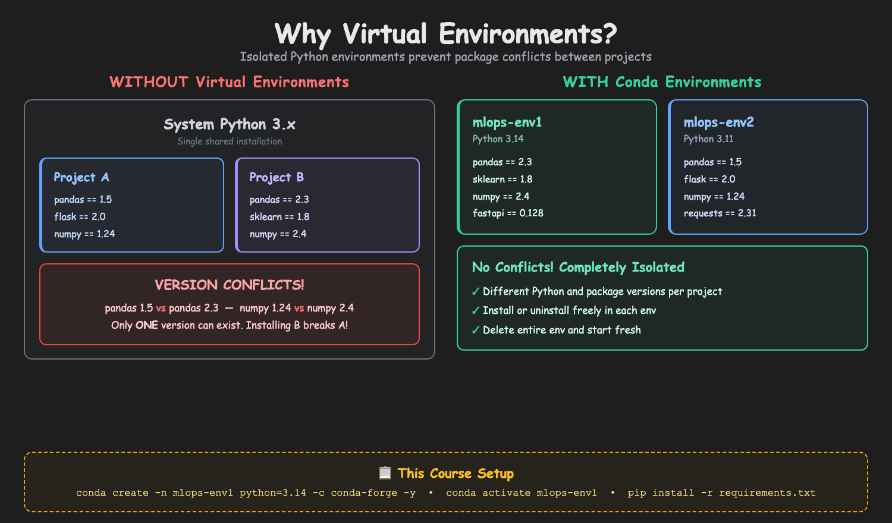

# 02 - Setup Python Environment

Before running any scripts, you need a Python environment with the required packages. This section guides you through installing Miniconda, creating a dedicated conda environment, and verifying your setup.

## Why Virtual Environments?



## Table of Contents

| Step | Topic |
|------|-------|
| Step-01 | [Install Miniconda](#step-01-install-miniconda) |
| Step-02 | [Create Conda Environment](#step-02-create-conda-environment) |
| Step-03 | [Install Dependencies](#step-03-install-dependencies) |
| Step-04 | [Verify Installation](#step-04-verify-installation) |

---

## Step-01: Install Miniconda

Download Miniconda from: **https://www.anaconda.com/docs/getting-started/installation**

### Step-01-01: macOS

```bash
# Option 1: Download from the website
# Go to https://www.anaconda.com/docs/getting-started/installation and download the macOS installer

# Option 2: Use Homebrew
brew install --cask miniconda

# After installation, initialize conda for your shell
# Check which shell you are using
echo $SHELL

# If /bin/zsh (default on macOS)
conda init zsh

# If /bin/bash
conda init bash

# Restart your terminal after running this
```

### Step-01-02: Windows

1. Download the **Windows installer** (.exe): "64-bit (x86_64)" for most PCs, "Arm64" only for Arm-based PCs.
2. Run it with the default options ("Just Me"). Leave **"Add Miniconda3 to my PATH environment variable" unchecked** (Anaconda does not recommend it).
3. Open **Anaconda PowerShell Prompt** from the Start menu (search "Anaconda PowerShell"), and run the commands of this course there: conda works in it, and so do the "Windows (PowerShell)" commands in later sections. ("Anaconda Prompt" works for the conda commands too, but it is a Command Prompt window.)
4. Optional, to use conda in a normal **PowerShell** window or the **VS Code terminal** too:

```powershell
# Run this once in Anaconda PowerShell Prompt, then close and reopen PowerShell
conda init powershell

# Only if PowerShell then says "running scripts is disabled on this system":
Set-ExecutionPolicy -Scope CurrentUser RemoteSigned
```

### Step-01-03: Linux

```bash
# Download and run the Miniconda installer (Arm Linux: Miniconda3-latest-Linux-aarch64.sh)
wget https://repo.anaconda.com/miniconda/Miniconda3-latest-Linux-x86_64.sh
bash Miniconda3-latest-Linux-x86_64.sh

# Set up conda for your bash terminal, then close it and open a new one
~/miniconda3/bin/conda init bash
```

The installer asks a few questions: press Enter to read the license, type `yes`, and keep the default folder (`~/miniconda3`). After this, the steps below are the same as on the Mac.

### Verify Installation (both platforms)

```bash
conda --version
```

**Expected Output:**
```
conda 26.x.x
```

Any recent version is fine.

### Accept Terms of Service (both platforms, one-time)

```bash
conda tos accept --override-channels --channel https://repo.anaconda.com/pkgs/main
conda tos accept --override-channels --channel https://repo.anaconda.com/pkgs/r
```

> **Note:** This is required once after a fresh Miniconda install. Without it, `conda create` will fail with a Terms of Service error.

---

## Step-02: Create Conda Environment

```bash
# Create environment with Python 3.14
conda create -n mlops-env1 python=3.14 -c conda-forge -y

# Activate environment
conda activate mlops-env1
```

**Expected Output:**
```
(mlops-env1) $    # Your prompt shows the active environment
```

---

## Step-03: Install Dependencies

```bash
# Navigate to the project folder
cd 02_Setup_Python/ccfd-project

# Install from requirements file
pip install -r requirements.txt
```

> **Alternative:** If you're using the shared folder, run from `ccfd-project-main/` instead. See [Shared Project Folder](../README.md#shared-project-folder-alternative) in the root README.

**Key packages installed:**

| Package | Version | Purpose |
|---------|---------|---------|
| scikit-learn | 1.8.0 | ML algorithms, pipelines |
| pandas | 2.3.3 | Data manipulation |
| numpy | 2.4.1 | Numerical operations |
| matplotlib | 3.10.8 | Visualizations |
| seaborn | 0.13.2 | Statistical plots |
| fastapi | 0.128.0 | Inference API |
| uvicorn | 0.40.0 | API server |

> **Note:** Exact pinned versions are in `requirements.txt` for reproducibility.

---

## Step-04: Verify Installation

```bash
python -c "import sklearn; import pandas; import numpy; print('All packages OK')"
python -c "import sklearn; print(f'sklearn version: {sklearn.__version__}')"
```

**Expected Output:**
```
All packages OK
sklearn version: 1.8.0
```

---

## Environment Commands Reference

| Command | Purpose |
|---------|---------|
| `conda activate mlops-env1` | Activate environment |
| `conda deactivate` | Deactivate environment |
| `conda env list` | List all environments |
| `conda env remove -n mlops-env1` | Delete environment |

---

## Troubleshooting

**"conda: command not found" (macOS and Linux)**
- Restart your terminal after Miniconda installation
- Run conda's own init with its full path, then restart the terminal: `~/miniconda3/bin/conda init zsh` (Homebrew Miniconda: `/opt/homebrew/Caskroom/miniconda/base/bin/conda init zsh`; use `bash` instead of `zsh` if `echo $SHELL` shows `/bin/bash`)
- Or manually: `source ~/.zshrc`

**"conda is not recognized" (Windows)**
- Use **Anaconda PowerShell Prompt** from the Start menu
- Or, in Anaconda PowerShell Prompt, run `conda init powershell`, then close and reopen PowerShell

**"pip is not found" in a new environment (both platforms)**
- Activate the environment, then install pip into it:

```bash
conda activate mlops-env1
conda install pip
```

**Package conflicts (both platforms)**
```bash
# Remove and recreate environment
conda env remove -n mlops-env1
conda create -n mlops-env1 python=3.14 -c conda-forge -y
conda activate mlops-env1
pip install -r requirements.txt
```

---

## Next Steps

| Next | Topic | What You'll Do |
|------|-------|---------------|
| [03_Generate_Dataset](../03_Generate_Dataset/) | Synthetic Data | Generate 10,000 credit card transactions with realistic fraud patterns |
