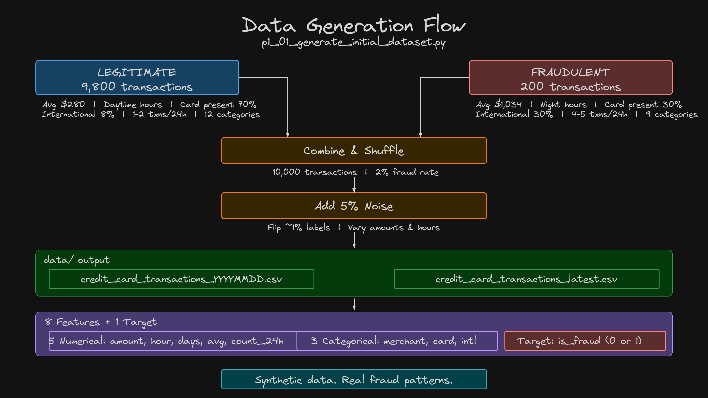

# 03 - Generate Synthetic Dataset

This section generates synthetic credit card transaction data for fraud detection. We create our own data rather than using public datasets to avoid licensing issues and ensure realistic fraud patterns. The synthetic data mimics real-world characteristics: fraudsters make larger transactions, operate at unusual hours, and show rapid transaction bursts.

## ML and CCFD Workflow


## Architecture



## Table of Contents

| Step | Topic |
|------|-------|
| Step-01 | [Review the Generator Script](#step-01-review-the-generator-script) |
| Step-02 | [Run Data Generation](#step-02-run-data-generation) |
| Step-03 | [Verify the Dataset](#step-03-verify-the-dataset) |


## Pre-requisite: Python Environment Setup

```bash
# Create conda environment
conda create -n mlops-env1 python=3.14 -c conda-forge -y

# Activate environment
conda activate mlops-env1

# Install dependencies (locked versions)
cd ccfd-project
pip install -r requirements.txt
```

> **Note:** All sections in this course use the same `mlops-env1` environment. You only need to create it once. After that, just activate it with `conda activate mlops-env1` before running any scripts.

---

---

## Step-01: Review the Generator Script

The generator script lives in the `ccfd-project/` folder:

| File | Description |
|------|-------------|
| `ccfd-project/p1_01_generate_initial_dataset.py` | Generate 10,000 transactions (initial dataset) |

### Project Structure

```
03_Generate_Dataset/
├── README.md                          # This file
└── ccfd-project/
    ├── p1_01_generate_initial_dataset.py   # Generator script
    └── requirements.txt                    # Python dependencies
```

### How the Generator Works

The script creates two types of transactions:
- **Legitimate (9,800):** Normal spending patterns, daytime hours, moderate amounts, card present
- **Fraudulent (200):** Suspicious patterns, higher amounts, night hours, rapid bursts, card not present
- **5% noise** added for realism (amount variance, hour jitter, 1% label flips)

---

## Step-02: Run Data Generation

```bash
cd 03_Generate_Dataset/ccfd-project
python p1_01_generate_initial_dataset.py
```

> **Alternative:** If you're using the shared folder, run all commands from `ccfd-project-main/` instead. See [Shared Project Folder](../README.md#shared-project-folder-alternative) in the root README.

**Expected Output:**
```
======================================================================
CREDIT CARD FRAUD DETECTION - DATASET GENERATION
======================================================================

Generating transactions...
   Legitimate: 9,800 transactions
   Fraudulent: 200 transactions
   Applied 5% noise for realism

======================================================================
DATASET SUMMARY
======================================================================
   Total Transactions: 10,000
   Fraud Rate:         2.98%

   Legitimate: avg $280.68 | range $5.00 - $3259.33
   Fraudulent: avg $1034.33 | range $5.71 - $3243.64

======================================================================
FILES SAVED
======================================================================
   Timestamped: data/credit_card_transactions_YYYYMMDD_HHMMSS.csv
   Latest:      data/credit_card_transactions_latest.csv

======================================================================
DATASET GENERATION COMPLETE
======================================================================
```

**Files Created:**

| File | Description |
|------|-------------|
| `data/credit_card_transactions_latest.csv` | Main dataset (always use this) |
| `data/credit_card_transactions_YYYYMMDD_HHMMSS.csv` | Timestamped backup |

---

## Step-03: Verify the Dataset

### Check File Exists and Row Count
```bash
wc -l data/credit_card_transactions_latest.csv
```

**Windows (PowerShell):**

```powershell
(Get-Content data/credit_card_transactions_latest.csv).Count
```

**Expected:**
```
10001 data/credit_card_transactions_latest.csv    # 10000 rows + header
```

### Preview the Data
```bash
head -5 data/credit_card_transactions_latest.csv
```

**Windows (PowerShell):**

```powershell
Get-Content data/credit_card_transactions_latest.csv -TotalCount 5
```

**Expected:**
```
transaction_amount,transaction_hour,days_since_last_txn,avg_transaction_amount,merchant_category,card_present,international,transaction_count_24h,is_fraud
```

---

## Dataset Characteristics

### Features Generated

| Feature | Type | Description |
|---------|------|-------------|
| `transaction_amount` | Float | Dollar amount ($5 - $5000) |
| `transaction_hour` | Int | Hour of day (0-23) |
| `days_since_last_txn` | Int | Days since last transaction |
| `avg_transaction_amount` | Float | Customer's historical average |
| `merchant_category` | String | Type of merchant |
| `card_present` | String | yes/no, physical card used |
| `international` | String | yes/no, cross-border transaction |
| `transaction_count_24h` | Int | Transactions in last 24 hours |
| `is_fraud` | Int | Target: 0=legitimate, 1=fraud |

### Fraud Patterns Built Into Data

| Pattern | Legitimate | Fraudulent |
|---------|------------|------------|
| Average Amount | ~$280 | ~$1,034 |
| Transaction Hour | Daytime (9-18) | More uniform, slight night bias |
| 24h Transaction Count | 1-2 | 4-5 (rapid bursts) |
| Card Present | 70% yes | 30% yes |
| International | 8% yes | 30% yes |

These patterns allow the ML model to learn real fraud indicators.

---

## Next Steps

| Next | Topic | What You'll Do |
|------|-------|---------------|
| [04_Model_Training_and_Inference](../04_Model_Training_and_Inference/) | Train & Serve | Train a baseline model and serve predictions via API |
