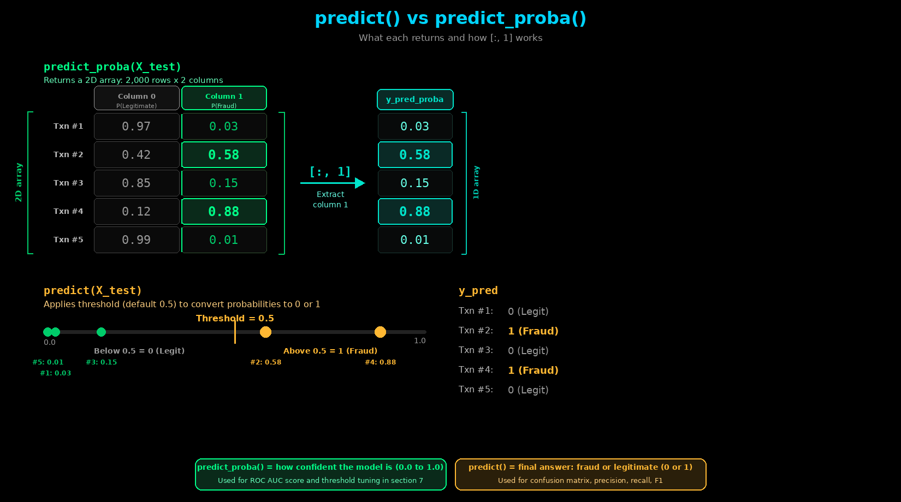
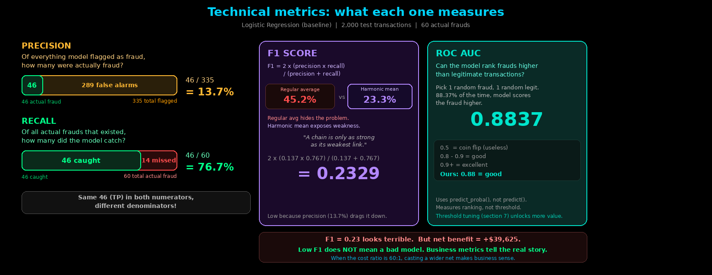
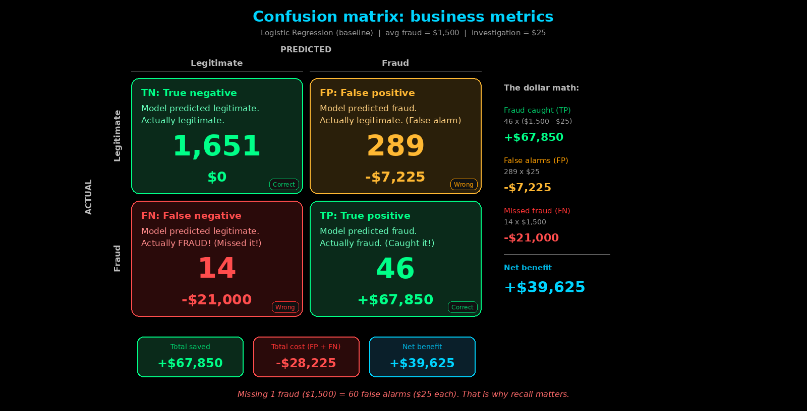

# v5 - Evaluate & Metrics

## Progress

```
  ✅ STEP 1: Load Data
  ✅ STEP 2: Split Train/Test
  ✅ STEP 3: Create Pipeline
  ✅ STEP 4: Train Pipeline
  🟡 STEP 5: Evaluate & Metrics      ← NEW IN THIS VERSION
  ⬜ STEP 6: Save Pipeline
  ⬜ STEP 7: Save Metrics JSON
```

## What's New

| File | Change |
|------|--------|
| `utils/metrics_utils.py` | Implemented `print_metrics()`, `calculate_business_metrics()`, `print_confusion_matrix()`, `_print_header()` |
| `utils/__init__.py` | Exports `print_metrics`, `calculate_business_metrics` |
| `p3_01_train_model_baseline.py` | Added STEP 5: predict + evaluate |

## New Functions

```python
# utils/metrics_utils.py
def calculate_business_metrics(y_true, y_pred, avg_fraud_amount=None, investigation_cost=None):
    """Compute net benefit, fraud caught, fraud missed, false alarms using confusion matrix."""

def print_metrics(algorithm_name, y_true, y_pred, y_pred_proba=None, avg_fraud_amount=None, investigation_cost=None):
    """Print technical metrics (F1, precision, recall, AUC) + business metrics + confusion matrix."""

def print_confusion_matrix(cm):
    """Format and print the 2x2 confusion matrix with row/column labels."""

def _print_header(title):
    """Private helper - prints a formatted banner for section headers."""
```

## Key Concept: predict() vs predict_proba()



Two lines, two different outputs:

```python
y_pred       = pipeline.predict(X_test)            # Hard 0/1 labels
y_pred_proba = pipeline.predict_proba(X_test)[:, 1] # Fraud probability (0.0 to 1.0)
```

- **`predict(X_test)`** - passes raw X_test through the Pipeline (preprocessor transforms, then model predicts). Returns `0` or `1` for each test row using the **default threshold of 0.5** - if fraud probability > 50%, predict fraud.
- **`predict_proba(X_test)`** - same preprocessing, but returns **probabilities** instead of hard 0/1. Returns a 2D array - column 0 is P(legitimate), column 1 is P(fraud). The `[:, 1]` extracts only the fraud probability.
- **Why both?** `predict()` gives the answer (fraud or not). `predict_proba()` gives the **confidence** (how sure the model is). We use probabilities later for ROC AUC and threshold optimization in Section 7.

## Key Concept: Technical Metrics



| Metric | Value | What It Measures |
|--------|-------|------------------|
| **Precision** | 0.1373 (13.7%) | Of all transactions flagged as fraud, how many were actually fraud? |
| **Recall** | 0.7667 (76.7%) | Of all actual frauds, how many did the model catch? |
| **F1 Score** | 0.2329 (23.3%) | Harmonic mean of precision and recall - one number that balances both |
| **ROC AUC** | 0.8837 (88.4%) | Pick one random fraud and one random legit - 88.4% of the time, the model scores the fraud higher |

- **F1 is the harmonic mean** - unlike a regular average (which would give 45.2% and hide the imbalance), harmonic mean pulls it down to 23.3%. A chain is only as strong as its weakest link.
- **ROC AUC uses probabilities**, not hard 0/1 predictions. A score of 0.8837 means good ranking ability - the threshold just needs tuning (Section 7).
- If you only looked at F1 and precision, you would think this model is terrible. **But wait for the business metrics.**

## Key Concept: Business Metrics > Technical Metrics



In fraud detection, **F1 score alone doesn't tell the story**. Two business constants drive everything:

```
Average fraud amount:    $1,500  (what a fraudster steals per transaction)
Investigation cost:      $25     (analyst time to review a flagged transaction)
Cost ratio:              60:1    (missing fraud is 60x more expensive than a false alarm)
```

### The Dollar Math (Confusion Matrix Breakdown)

| | Predicted Legit | Predicted Fraud |
|---|---|---|
| **Actually Legit** | TN = 1,651 → $0 cost | FP = 289 → 289 × $25 = **-$7,225** |
| **Actually Fraud** | FN = 14 → 14 × $1,500 = **-$21,000** | TP = 46 → 46 × $1,475 = **+$67,850** |

```
Net Benefit = Benefit(TP) - Cost(FP) - Cost(FN)
            = $67,850 - $7,225 - $21,000
            = $39,625
```

### Why Low Precision Is OK Here

Precision is only 13.7% - 289 false alarms for every 46 real catches. Sounds terrible. But:
- **Catching one more fraud** saves $1,475 (= $1,500 − $25 investigation)
- **One false alarm** costs only $25
- Catching one more fraud is **worth 59 false alarms**

A model with 13.7% precision generates **$39,625 in net benefit** because the cost ratio is 60:1. **Business metrics tell the real story.**

> **Baseline to beat:** $39,625 Net Benefit. Feature engineering improves this to $39,700. Threshold optimization takes it to $51,800.

## How to Run

```bash
cd v5_evaluate_and_metrics_ccfd-project/

# PRE-REQUISITE: Generate data first
python p1_01_generate_initial_dataset.py

# Run training script
python p3_01_train_model_baseline.py
```

**Expected Output (STEP 5):**
```
STEP 5: Evaluating Performance

======================================================================
Logistic Regression (Baseline) - PERFORMANCE METRICS
======================================================================

TECHNICAL METRICS:
   F1 Score:     0.2329
   Precision:    0.1373
   Recall:       0.7667
   ROC AUC:      0.8837

BUSINESS METRICS:
   Net Benefit:    $39,625
   Fraud Caught:   46
   Fraud Missed:   14
   False Alarms:   289

CONFUSION MATRIX:
                Predicted
                Legit  Fraud
   Actual Legit  1651   289
   Actual Fraud    14    46
```

## Next Version

**v6** → Implement `save_pipeline()` - save the trained model to disk as a pickle file.
