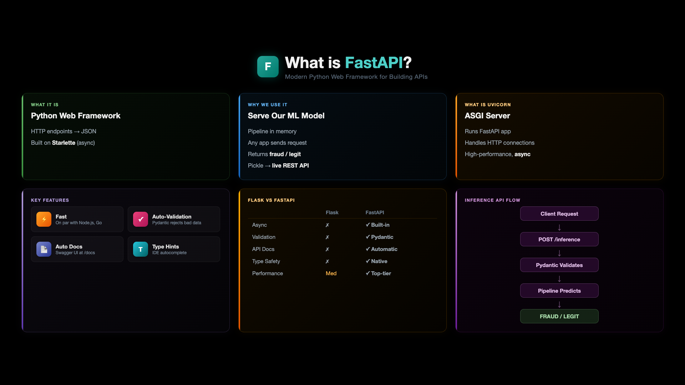
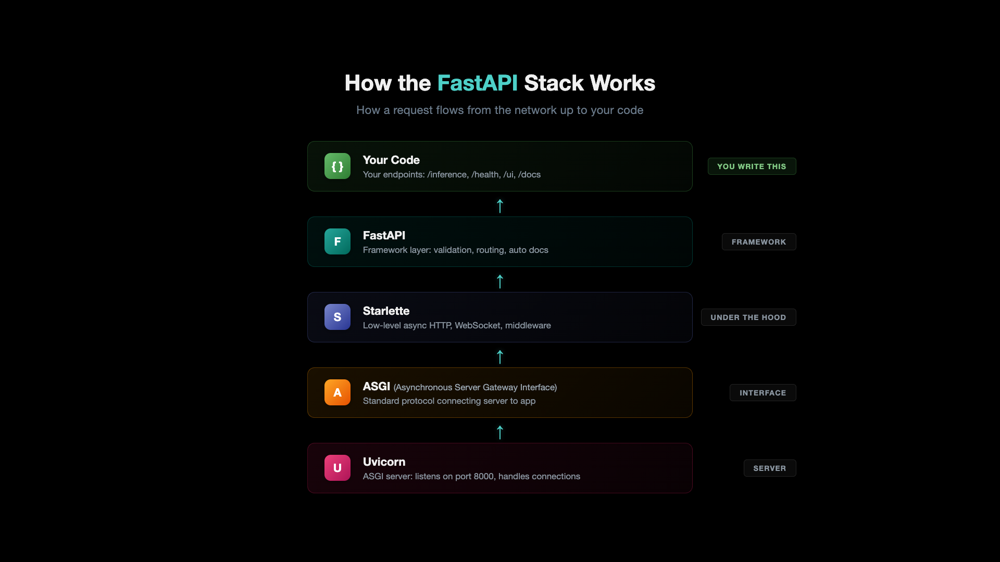

# 04_02 - Inference API

This demo serves the trained model via a FastAPI endpoint and tests it with sample transactions, both through a browser UI and automated test scripts.

---

## Key Concept: What is FastAPI?

[](../../images/04-02-01-WhatIsFastAPI.png)

**What It Is** - FastAPI is a modern Python web framework for building APIs. You define HTTP endpoints (GET, POST) that accept requests and return JSON responses. Built on **Starlette** (async) and **Uvicorn** (ASGI server), it is one of the fastest Python frameworks available.

### How the FastAPI Stack Works

[](../../images/04-02-02-FastAPIStack.png)

The diagram above shows how requests flow through the stack - from your code (endpoints like `/inference`, `/health`) through FastAPI (validation, routing), down through Starlette (async HTTP handling), the ASGI protocol (Asynchronous Server Gateway Interface), and finally Uvicorn (the server listening on port 8000).

**Why We Use It** - Our trained sklearn Pipeline sits as a pickle file on disk. FastAPI turns that pickle file into a **live, callable REST API**. Any application - browser, mobile, microservice - sends an HTTP request and gets a **fraud / legitimate** prediction back instantly.

**What is Uvicorn** - Uvicorn is the ASGI server that runs FastAPI. It handles incoming HTTP connections with high-performance async processing. FastAPI defines your endpoints, Uvicorn serves them.

**Key Features:**
- **Fast** - async by default, on par with Node.js and Go
- **Auto-Validation** - Pydantic rejects bad data before it reaches your code
- **Auto Docs** - Swagger UI at `/docs` with zero extra code
- **Type Hints** - IDE autocomplete and error checking

**Flask vs FastAPI** - Flask requires manual validation, manual async, and add-on packages for docs. FastAPI provides all of that built-in: Pydantic validation, async support, automatic Swagger docs, native type safety, and top-tier performance.

**Inference API Flow:**
```
Client Request → POST /inference → Pydantic Validates → Pipeline Predicts → FRAUD / LEGIT
```


## Pre-requisite: Python Environment Setup

```bash
# Create conda environment
conda create -n mlops-env1 python=3.14 -c conda-forge -y

# Activate environment
conda activate mlops-env1

# Install dependencies (locked versions)
cd ccfd-project
pip install -r requirements.txt
```

> **Note:** All sections in this course use the same `mlops-env1` environment. You only need to create it once. After that, just activate it with `conda activate mlops-env1` before running any scripts.

---

---

## Step-01: Review the API Scripts

| File | Description |
|------|-------------|
| `ccfd-project/p3_02_inference_api_baseline.py` | FastAPI inference server (port 8000) |
| `ccfd-project/p3_03_inference_test_baseline.py` | Automated API test script (3 test cases) |
| `ccfd-project/templates/index.html` | Browser-based testing UI |

### Project Structure

```
04_02_Inference_API/
├── README.md                              # This file
└── ccfd-project/
    ├── p3_02_inference_api_baseline.py    # FastAPI server
    ├── p3_03_inference_test_baseline.py   # Test script
    ├── requirements.txt                   # Python dependencies
    ├── utils/
    │   ├── __init__.py
    │   ├── data_utils.py
    │   └── model_utils.py
    └── templates/
        └── index.html                     # Browser testing UI
```

### API Endpoints

| Endpoint | Method | Description |
|----------|--------|-------------|
| `/` | GET | API information |
| `/health` | GET | Health check |
| `/ui` | GET | Browser-based testing form |
| `/inference` | POST | Make prediction |
| `/docs` | GET | Swagger UI documentation |

---

## Step-02: Start the API Server

> **Prerequisite:** Each section has its own `ccfd-project/` folder. You must generate data and train the model first before starting the API.

```bash
# Terminal 1: Generate data, train model, start API
cd 04_Model_Training_and_Inference/04_02_Inference_API/ccfd-project
python p1_01_generate_initial_dataset.py    # Generate data (required first)
python p3_01_train_model_baseline.py        # Train model (required for API)
python p3_02_inference_api_baseline.py      # Start API server
```

> **Alternative:** If you're using the shared folder, run all commands from `ccfd-project-main/` instead. See [Shared Project Folder](../../README.md#shared-project-folder-alternative) in the root README.

**Expected Output:**
```
======================================================================
BASELINE INFERENCE API
======================================================================

Loading model from: models/p3_01_baseline/
Model loaded successfully!
   Model: LogisticRegression
   Features: 8
   Threshold: 0.5

Starting server on http://127.0.0.1:8000
API docs: http://127.0.0.1:8000/docs
Test UI: http://127.0.0.1:8000/ui
```

---

## Step-03: Test in Browser

Open **http://127.0.0.1:8000/ui** in your browser.

> **Note (Windows):** the `/ui` code opens the page with `open(template_path, 'r', encoding='utf-8')`. The video shows it without `encoding='utf-8'`; on macOS and Linux both work, but on Windows the page needs it, because the page has emoji and Windows does not read files as UTF-8 by default.

The browser UI provides a form where you can enter transaction details and get real-time predictions. Try these test scenarios:

| Scenario | Amount | Hour | Merchant | Card Present | International | Expected |
|----------|--------|------|----------|-------------|---------------|----------|
| Normal grocery | $50 | 14 | grocery | yes | no | Legitimate |
| Suspicious | $2,500 | 3 | electronics | no | yes | Fraud |
| Edge case | $1,500 | 2 | jewelry | no | yes | Fraud |

---

## Step-04: Run Automated Tests

```bash
# Terminal 2: Run test script (keep API running in Terminal 1)
cd 04_Model_Training_and_Inference/04_02_Inference_API/ccfd-project
python p3_03_inference_test_baseline.py
```

**Test Transactions (built into script):**

| # | Transaction | Amount | Hour | Expected Risk |
|---|-------------|--------|------|---------------|
| 1 | Normal grocery | $50 | 14 (2 PM) | Low |
| 2 | Suspicious electronics | $2,500 | 3 (3 AM) | High |
| 3 | High value jewelry | $1,500 | 2 (2 AM) | Medium-High |

**Expected Output:**
```
======================================================================
Testing Health Endpoint
======================================================================
Status: healthy
Model Loaded: True

======================================================================
Testing Predictions
======================================================================

Normal Transaction
   Amount: $50.00 | Merchant: grocery
   Prediction: legitimate (probability: 0.05)
   PASSED

Suspicious Transaction (High Amount)
   Amount: $2500.00 | Merchant: electronics
   Prediction: fraud (probability: 0.89)
   PASSED

Edge Case (High Value Jewelry)
   Amount: $1500.00 | Merchant: jewelry
   Prediction: fraud (probability: 0.72)
   PASSED

Tests passed: 3/3
```

### Manual curl Test

```bash
curl -X POST http://127.0.0.1:8000/inference \
  -H "Content-Type: application/json" \
  -d '{
    "transaction_amount": 2500.00,
    "transaction_hour": 3,
    "days_since_last_txn": 0,
    "avg_transaction_amount": 100.00,
    "merchant_category": "electronics",
    "card_present": "no",
    "international": "yes",
    "transaction_count_24h": 7
  }'
```

**Windows (PowerShell):**

```powershell
$body = @{
  transaction_amount     = 2500.00
  transaction_hour       = 3
  days_since_last_txn    = 0
  avg_transaction_amount = 100.00
  merchant_category      = "electronics"
  card_present           = "no"
  international          = "yes"
  transaction_count_24h  = 7
} | ConvertTo-Json
Invoke-RestMethod -Method Post -Uri http://127.0.0.1:8000/inference -ContentType "application/json" -Body $body
```

PowerShell shows the same fields as a list (`prediction : ...`). The easiest way on any computer is the API's own page: http://127.0.0.1:8000/docs, then "Try it out".

**Expected Response:**
```json
{
  "prediction": "FRAUD",
  "probability": 0.89,
  "threshold": 0.5,
  "risk_score": "HIGH",
  "confidence": 0.78,
  "model_name": "p3_01_baseline",
  "message": "Transaction flagged as FRAUD (probability: 0.89)"
}
```

---

## Step-05: Recap - What We Built

| Component | What It Does |
|-----------|-------------|
| **Data Generator** | Creates 10,000 synthetic transactions with realistic fraud patterns |
| **Training Pipeline** | sklearn Pipeline (OneHotEncoder + StandardScaler + LogisticRegression) |
| **Inference API** | FastAPI server with real-time fraud predictions |
| **Browser UI** | Interactive testing form at `/ui` |
| **Test Script** | Automated validation with 3 test scenarios |

### Business Results

| Metric | Value |
|--------|-------|
| Fraud Caught | 46/60 (77%) |
| False Alarms | 289 |
| **Net Benefit** | **$39,625** |

This is the **core pattern** - data -> train -> serve. MLOps tools such as DVC, MLflow, Kubernetes, CI/CD and Kubeflow (not part of this course) build on top of this foundation.

---

## Next Steps

| Next | Topic | What You'll Do |
|------|-------|---------------|
| [05_EDA_and_Preprocessing](../../05_EDA_and_Preprocessing/) | Exploratory Data Analysis | Analyze fraud patterns, correlations, generate visualizations |
