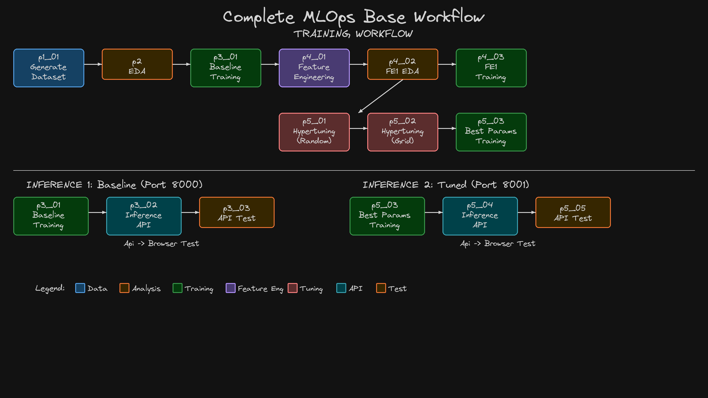
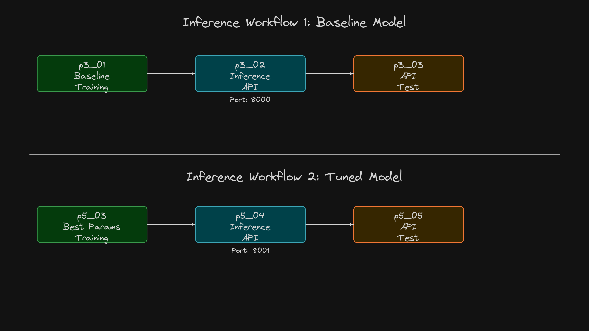
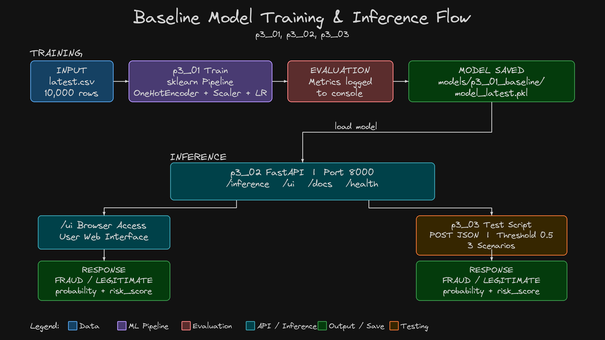

# 04 - Model Training and Inference

This section trains a baseline Logistic Regression model for fraud detection and serves predictions via a FastAPI endpoint. The baseline establishes a performance benchmark using sklearn's Pipeline to combine preprocessing (encoding, scaling) with the classifier.

## Complete Workflow



## Inference Workflow



## Architecture




## Pre-requisite: Python Environment Setup

```bash
# Create conda environment
conda create -n mlops-env1 python=3.14 -c conda-forge -y

# Activate environment
conda activate mlops-env1

# Install dependencies (locked versions)
cd 04_01_Train_Baseline_Model/ccfd-project
pip install -r requirements.txt
```

> **Note:** All sections in this course use the same `mlops-env1` environment. You only need to create it once. After that, just activate it with `conda activate mlops-env1` before running any scripts.

---

---

## What You Will Learn

| Demo | Topic | Key Concepts |
|------|-------|-------------|
| [04_01_Train_Baseline_Model](04_01_Train_Baseline_Model/) | Train the model | sklearn Pipeline, class_weight='balanced', business metrics |
| [04_02_Inference_API](04_02_Inference_API/) | Serve and test predictions | FastAPI, REST API, browser UI, automated testing |

---

## Scripts

| Script | Purpose | Location |
|--------|---------|----------|
| `p3_01_train_model_baseline.py` | Train baseline Logistic Regression | `04_01_Train_Baseline_Model/ccfd-project/` |
| `p3_02_inference_api_baseline.py` | Serve predictions via FastAPI (port 8000) | `04_02_Inference_API/ccfd-project/` |
| `p3_03_inference_test_baseline.py` | Test the API with sample transactions | `04_02_Inference_API/ccfd-project/` |

---

## Baseline Results Summary

| Metric | Value | Interpretation |
|--------|-------|----------------|
| F1 Score | 0.2329 | Balance of precision/recall |
| Precision | 0.1373 | 13.7% of fraud predictions are correct |
| Recall | 0.7667 | Catches 77% of actual fraud (46/60) |
| ROC AUC | 0.8837 | Good discrimination ability |
| **Net Benefit** | **$39,625** | Business value (fraud saved - false alarm costs) |

---

## Next Steps

| Next | Topic | What You'll Do |
|------|-------|---------------|
| [05_EDA_and_Preprocessing](../05_EDA_and_Preprocessing/) | Exploratory Data Analysis | Analyze fraud patterns, correlations, generate visualizations |
