# 05 - EDA and Preprocessing

Exploratory Data Analysis (EDA) helps us understand the data before building models. This section analyzes transaction patterns, identifies differences between legitimate and fraudulent transactions, and generates visualizations. Understanding these patterns informs feature engineering and model selection decisions.

## What You Will Learn

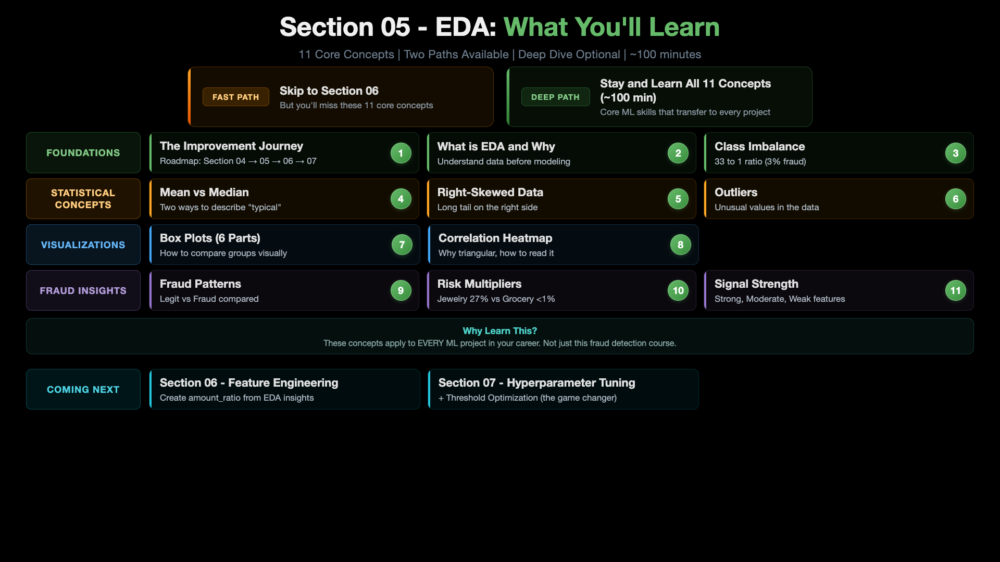

This section is an **optional deep dive** into EDA and statistical concepts. You have two paths:

- **Fast Path** - Skip ahead to [Section 06: Feature Engineering](../06_Feature_Engineering/) and apply the `amount_ratio` feature directly.
- **Deep Path** (about 3 hours, with the optional auto-EDA tools) - Stay and learn the EDA concepts below.

The concepts here explain **why** we engineer the `amount_ratio` feature in Section 06. If you want to understand the reasoning behind feature choices (not just copy them), the Deep Path is worth your time.

## ML and CCFD Workflow


## Architecture

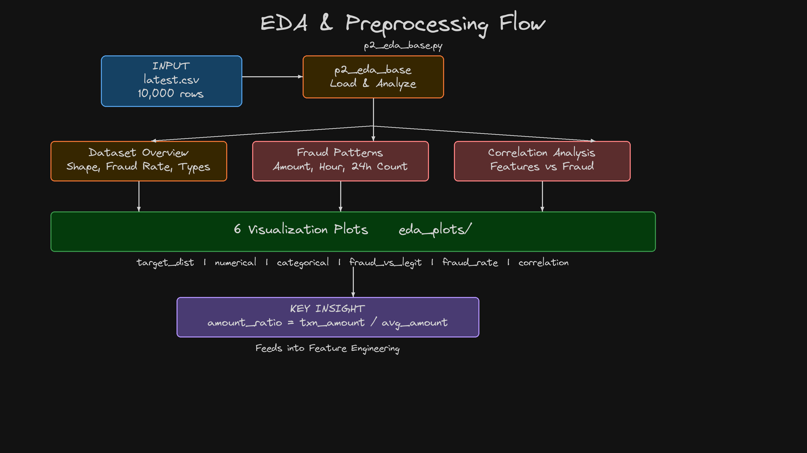

## Key Concept: What is Feature Engineering?

[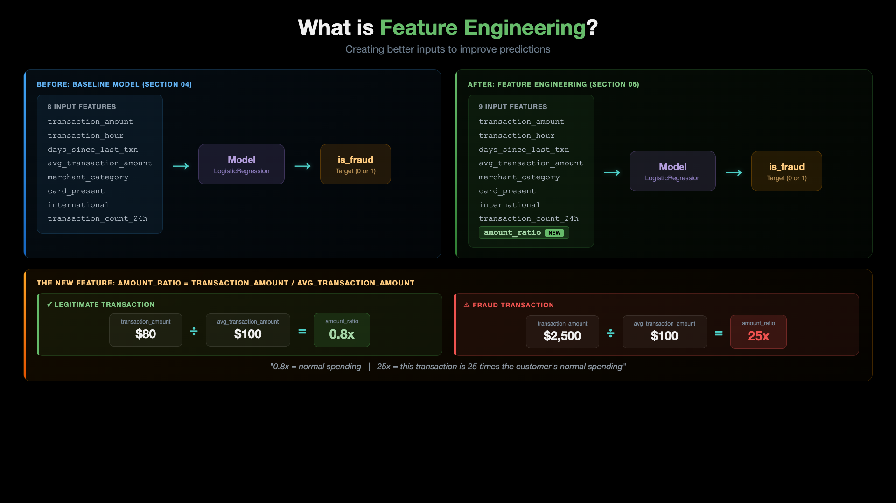](../images/05-00-02-WhatIsFeatureEngineering.png)

EDA is the first step in improving our baseline model. The goal is to discover patterns in the data that lead to **Feature Engineering** - creating new input features that help the model make better predictions. In our case, EDA reveals that `transaction_amount` and `avg_transaction_amount` together suggest a powerful new feature: `amount_ratio = transaction_amount / avg_transaction_amount`.

## Key Concept: What is a Box Plot?

[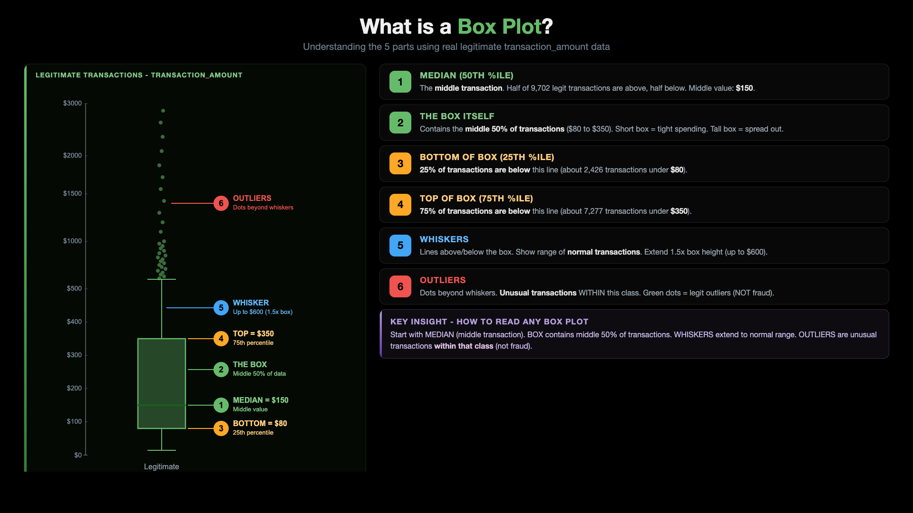](../images/05-00-03-WhatIsBoxPlot.png)

Box plots are the key visualization we use in EDA to **compare fraud vs legitimate transactions side by side**. The diagram above explains the 6 parts of a box plot using real legitimate transaction data - starting with the median (the middle transaction), the box (middle 50% of transactions), the percentiles (25th and 75th), the whiskers (normal range), and finally outliers (unusual transactions within that class). If the fraud box and legit box overlap heavily → weak signal. If they are separated → strong signal.

## Table of Contents

| Step | Topic |
|------|-------|
| Step-01 | [Review the EDA Script](#step-01-review-the-eda-script) |
| Step-02 | [Run EDA Analysis](#step-02-run-eda-analysis) |
| Step-03 | [Review Generated Plots](#step-03-review-generated-plots) |
| Step-04 | [Key Findings](#step-04-key-findings) |
| Step-05 | [Feature Engineering Opportunity](#step-05-feature-engineering-opportunity) |
| Step-06 | [Real-World Shortcut: Auto-EDA Tools (Optional)](#step-06-real-world-shortcut---auto-eda-tools-optional) |

---

## Pre-requisite: Python Environment Setup

```bash
# Create conda environment
conda create -n mlops-env1 python=3.14 -c conda-forge -y

# Activate environment
conda activate mlops-env1

# Install dependencies (locked versions)
cd ccfd-project
pip install -r requirements.txt
```

> **Note:** All sections in this course use the same `mlops-env1` environment. You only need to create it once. After that, just activate it with `conda activate mlops-env1` before running any scripts.

---

## Step-01: Review the EDA Script

| File | Description |
|------|-------------|
| `ccfd-project/p2_eda_base.py` | 5-section analysis with 6 visualizations |

The EDA script performs:
1. **Dataset Overview** - shape, fraud rate, feature types
2. **Target Distribution** - fraud vs legitimate counts
3. **Feature Distributions** - numerical histograms, categorical bar charts
4. **Fraud Pattern Analysis** - side-by-side comparison of fraud vs legitimate
5. **Correlation Analysis** - which features correlate most with fraud

---

## Step-02: Run EDA Analysis

> **Prerequisite:** Each section has its own `ccfd-project/` folder. You must generate data first before running EDA.

```bash
cd 05_EDA_and_Preprocessing/ccfd-project
python p1_01_generate_initial_dataset.py    # Generate data (required first)
python p2_eda_base.py                       # Run EDA analysis
```

> **Alternative:** If you're using the shared folder, run all commands from `ccfd-project-main/` instead. See [Shared Project Folder](../README.md#shared-project-folder-alternative) in the root README.

**Expected Output:**
```
======================================================================
EXPLORATORY DATA ANALYSIS - CREDIT CARD FRAUD DETECTION
======================================================================

======================================================================
SECTION 1: DATASET OVERVIEW
======================================================================
Loaded 10,000 transactions

   Shape: (10000, 9)
   Fraud Rate: 2.98%

   Categorical: ['merchant_category', 'card_present', 'international']
   Numerical:   ['transaction_amount', 'transaction_hour', 'days_since_last_txn',
                 'avg_transaction_amount', 'transaction_count_24h']

======================================================================
SECTION 4: FRAUD PATTERN ANALYSIS
======================================================================

   Feature                     Legitimate        Fraud       Diff
   ------------------------------------------------------------
   transaction_amount              280.68      1034.33    +268.5%
   transaction_hour                 13.06        10.90     -16.5%
   days_since_last_txn               3.71         2.02     -45.4%
   avg_transaction_amount          180.31       139.52     -22.6%
   transaction_count_24h             1.81         3.54     +95.4%

======================================================================
SECTION 5: CORRELATION ANALYSIS
======================================================================

   Correlation with Fraud:
   transaction_amount       : +0.3111 (Strong)
   transaction_count_24h    : +0.2689 (Moderate)
   card_present             : +0.0877 (Weak)
   merchant_category        : +0.0815 (Weak)
   transaction_hour         : -0.0702 (Weak)
   days_since_last_txn      : -0.0625 (Weak)
   international            : +0.0619 (Weak)
   avg_transaction_amount   : -0.0544 (Weak)

======================================================================
EDA COMPLETE! Check 'eda_plots/' folder for visualizations.
======================================================================
```

---

## Step-03: Review Generated Plots

All plots saved to `eda_plots/` folder:

| File | Description |
|------|-------------|
| `01_target_distribution.png` | Fraud vs legitimate transaction counts (bar chart) |
| `02_numerical_distributions.png` | Histograms of all numerical features |
| `03_categorical_distributions.png` | Bar charts of merchant_category, card_present, international |
| `04_fraud_vs_legitimate_numerical.png` | Side-by-side box plots comparing fraud vs legit |
| `05_fraud_rate_by_category.png` | Fraud rate % for each merchant category |
| `06_correlation_heatmap.png` | Feature correlation matrix with fraud target |

### Target Distribution (Class Imbalance - 33:1)

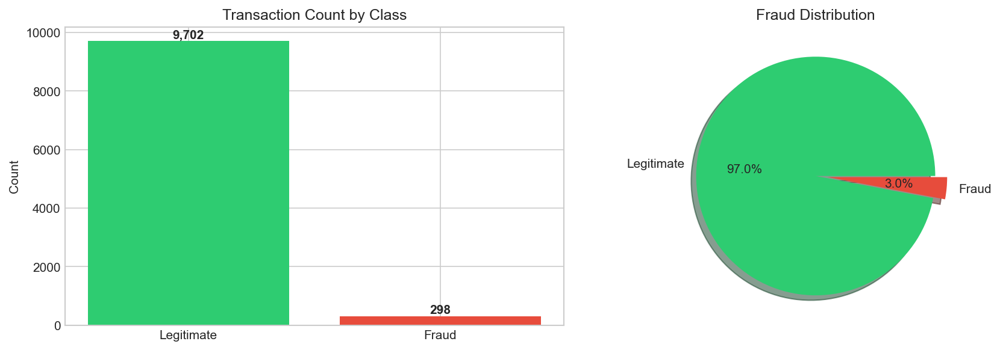

### Numerical Feature Distributions

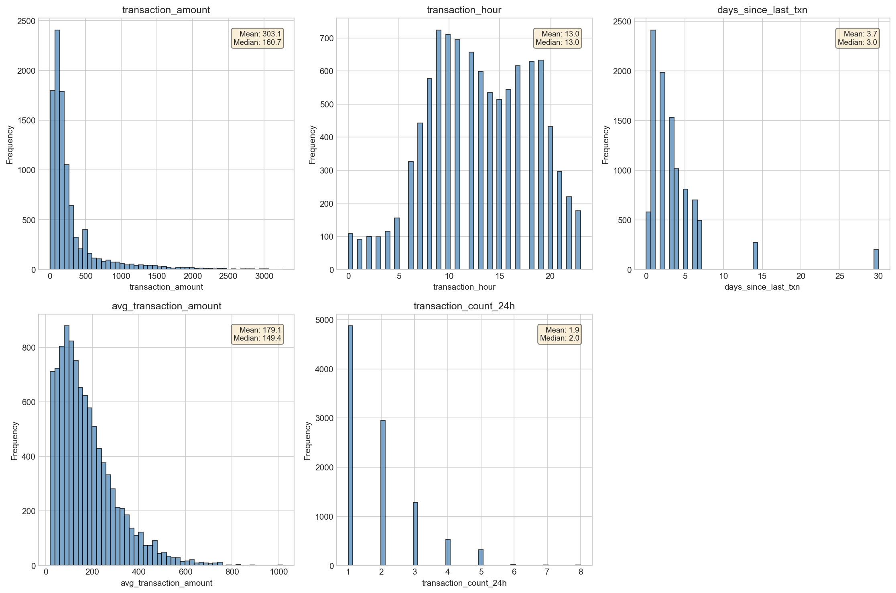

### Categorical Feature Distributions

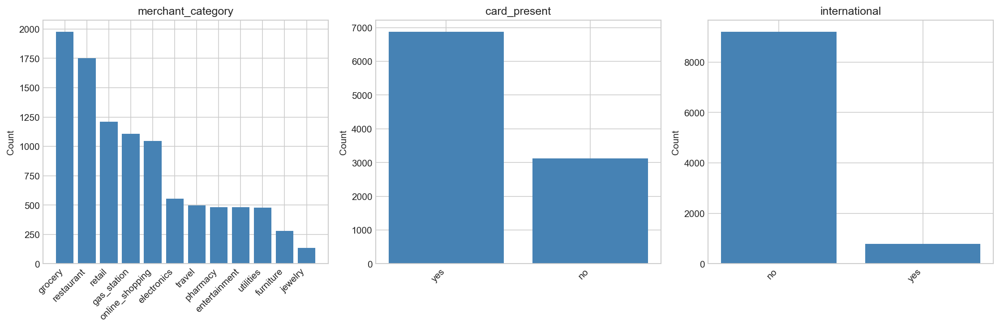

### Fraud vs Legitimate - Box Plots

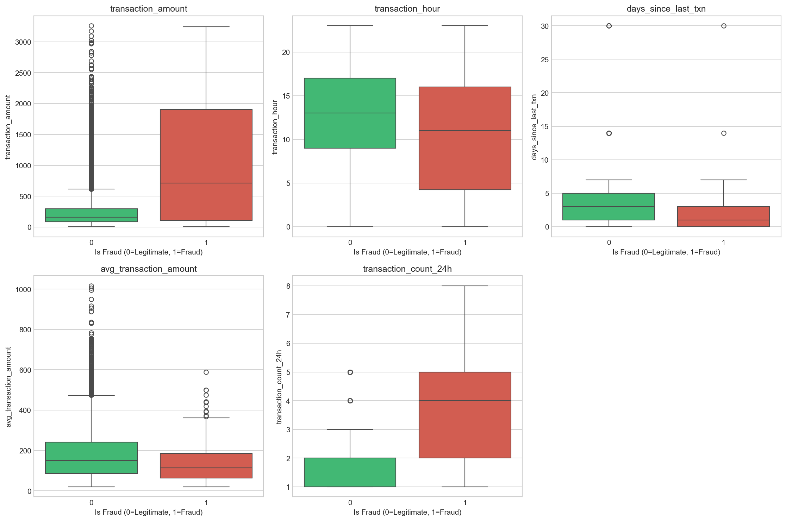

### Fraud Rate by Category

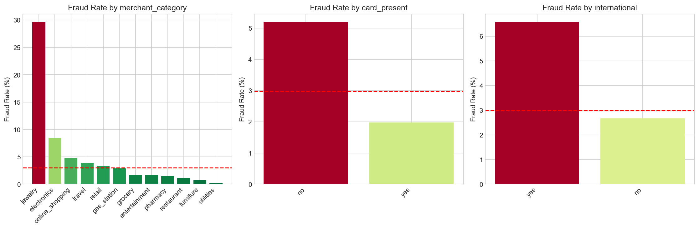

### Correlation Heatmap

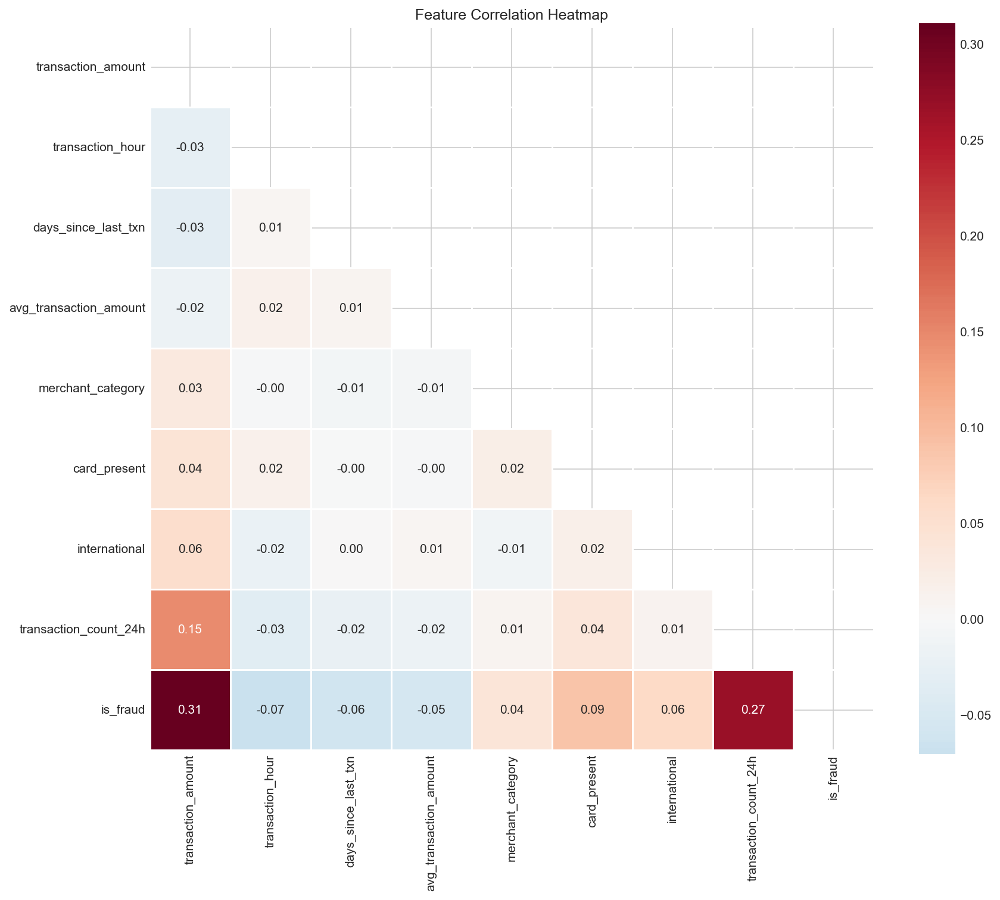

### View the Plots

```bash
# List all generated plots
ls -la eda_plots/

# Open plots (macOS)
open eda_plots/01_target_distribution.png
open eda_plots/04_fraud_vs_legitimate_numerical.png
open eda_plots/06_correlation_heatmap.png
```

On Linux, use `xdg-open` instead of `open`.

**Windows (PowerShell):**

```powershell
# List all generated plots
Get-ChildItem eda_plots

# Open plots
Invoke-Item eda_plots/01_target_distribution.png
Invoke-Item eda_plots/04_fraud_vs_legitimate_numerical.png
Invoke-Item eda_plots/06_correlation_heatmap.png
```

---

## Step-04: Key Findings

### Fraud vs Legitimate Patterns

| Feature | Legitimate | Fraud | Key Insight |
|---------|------------|-------|-------------|
| transaction_amount | $280.68 avg | $1,034.33 avg | Fraudsters spend **3.7x more** |
| transaction_hour | 13.06 avg | 10.90 avg | Fraud slightly more at night |
| transaction_count_24h | 1.81 avg | 3.54 avg | Fraud = **rapid transaction bursts** |
| days_since_last_txn | 3.71 avg | 2.02 avg | Fraud happens more frequently |

### Strongest Fraud Indicators

| Feature | Correlation | Strength |
|---------|-------------|----------|
| transaction_amount | +0.31 | Strong |
| transaction_count_24h | +0.27 | Moderate |
| card_present | +0.09 | Weak |

---

## Step-05: Feature Engineering Opportunity

The high correlation of `transaction_amount` (+0.31) combined with `avg_transaction_amount` (-0.05) suggests creating a **ratio feature**:

```
amount_ratio = transaction_amount / avg_transaction_amount
```

- Fraudsters spend much more than the victim's normal spending pattern
- This ratio captures behavioral deviation
- We'll create and evaluate this feature in the next section

---

## Step-06: Real-World Shortcut - Auto-EDA Tools (Optional)

[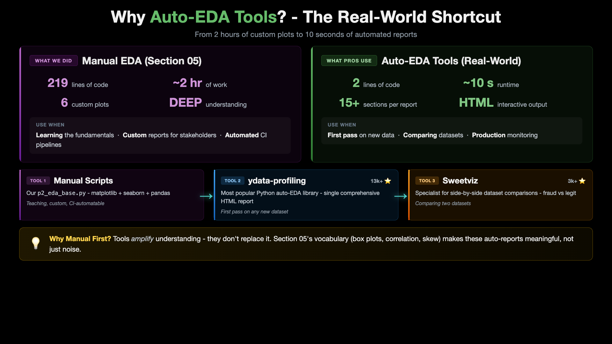](../images/05-00-04-WhyAutoEDATools.png)

Now that you've learned EDA manually (box plots, correlation, fraud patterns, distributions), production data scientists reach for automated tools that generate the same reports in seconds. This section shows the two most popular options:

- **`fg-data-profiling`** (`p2_02`) - the industry-standard, comprehensive auto-EDA report
- **Sweetviz** (`p2_03`) - specialized for side-by-side dataset comparisons (fraud vs legit)

Both tools are installed into a **single dedicated environment** (`eda-tools-env`) so your core `mlops-env1` and its locked `requirements.txt` stay clean and untouched.

### Shared Setup (one-time)

`fg-data-profiling` needs a Python 3.13 environment because it uses `pydantic.v1` (incompatible with Python 3.14) and `pkg_resources` (removed from newer setuptools). Sweetviz happily lives in the same env.

```bash
# Create the dedicated auto-EDA environment (one-time)
conda create -n eda-tools-env python=3.13 -c conda-forge -y
conda activate eda-tools-env

# Install BOTH auto-EDA tools at locked versions (recommended)
cd 05_EDA_and_Preprocessing/ccfd-project
pip install -r requirements-auto-eda-tools.txt
```

> **What `requirements-auto-eda-tools.txt` installs:** `setuptools<81`, `fg-data-profiling==4.19.1`, `sweetviz==2.3.3` - exact versions used while recording this course, so your reports match the lectures 1:1.

> **Package rename note (`fg-data-profiling`):** This tool was originally `pandas-profiling`, then `ydata-profiling`, and is now `fg-data-profiling` (under the Data-Centric-AI-Community organization). Same project, same 13.5k-star codebase, same MIT license, same maintainers - just renamed twice over its 9-year history.
>
> - **GitHub repo:** https://github.com/Data-Centric-AI-Community/fg-data-profiling
> - **PyPI page:** https://pypi.org/project/fg-data-profiling/
> - PyPI install name: `fg-data-profiling` (with `fg-` prefix)
> - Python import name: `data_profiling` (no `fg_` prefix)

### Generate Data (in mlops-env1)

```bash
conda activate mlops-env1
cd 05_EDA_and_Preprocessing/ccfd-project
python p1_01_generate_initial_dataset.py
```

### Tool 1: fg-data-profiling (Industry Reference - Primary)

The canonical auto-EDA tool (13k+ GitHub stars). One line of code generates a comprehensive HTML report with: dataset overview, per-variable distributions, correlations (Pearson, Spearman, Kendall, phi-k, Cramer's V), auto-flagged warnings, and duplicate detection.

```bash
conda activate eda-tools-env
python p2_02_auto_eda_ydata_profiling.py
open auto_eda_reports/data_profiling/*.html
```

On Linux, use `xdg-open` instead of `open`. On Windows, open the reports with:

```powershell
Invoke-Item auto_eda_reports/data_profiling/*.html
```

**Output:** 2 HTML reports in `auto_eda_reports/data_profiling/`:
- `ccfd_full_profile.html` - complete dataset profile
- `ccfd_fraud_vs_legit_comparison.html` - two profiles side-by-side

### Tool 2: Sweetviz (Best for Comparisons - Secondary)

Specialized for SIDE-BY-SIDE dataset comparisons - perfect for fraud vs legitimate, or train vs test.

```bash
conda activate eda-tools-env
python p2_03_auto_eda_sweetviz.py
open auto_eda_reports/sweetviz/*.html
```

On Linux, use `xdg-open` instead of `open`. On Windows, open the reports with:

```powershell
Invoke-Item auto_eda_reports/sweetviz/*.html
```

**Output:** 2 HTML reports in `auto_eda_reports/sweetviz/`:
- `ccfd_general_analysis.html` - dataset overview with target annotation
- `ccfd_fraud_vs_legit_comparison.html` - fraud vs legit side-by-side (the most useful one for our story)

### When to Use Which Tool

| Tool | Best for | Runtime |
|------|----------|---------|
| **Manual `p2_eda_base.py`** | Learning EDA, teaching, reproducible custom reports | ~3 sec |
| **`fg-data-profiling`** (`p2_02`) | First pass on any new dataset (industry default) | ~8 sec |
| **Sweetviz** (`p2_03`) | Comparing two datasets (fraud vs legit, train vs test) | ~4 sec |

### Why We Taught EDA Manually First

Tools amplify understanding - they don't replace it. You needed Section 05's manual EDA to build the vocabulary (box plots, percentiles, correlation strength, skewness) that makes the auto-generated reports meaningful. A 15-section auto-generated report is overwhelming without that foundation.

In your day-to-day MLOps work, you'll likely mix all three: notebooks for interactive exploration, auto-EDA tools for fast first-pass reports, and custom scripts like `p2_eda_base.py` for automated data quality checks in CI/CD.

---

## Next Steps

| Next | Topic | What You'll Do |
|------|-------|---------------|
| [06_Feature_Engineering](../06_Feature_Engineering/) | Create Features | Build amount_ratio, analyze it, retrain the model |
