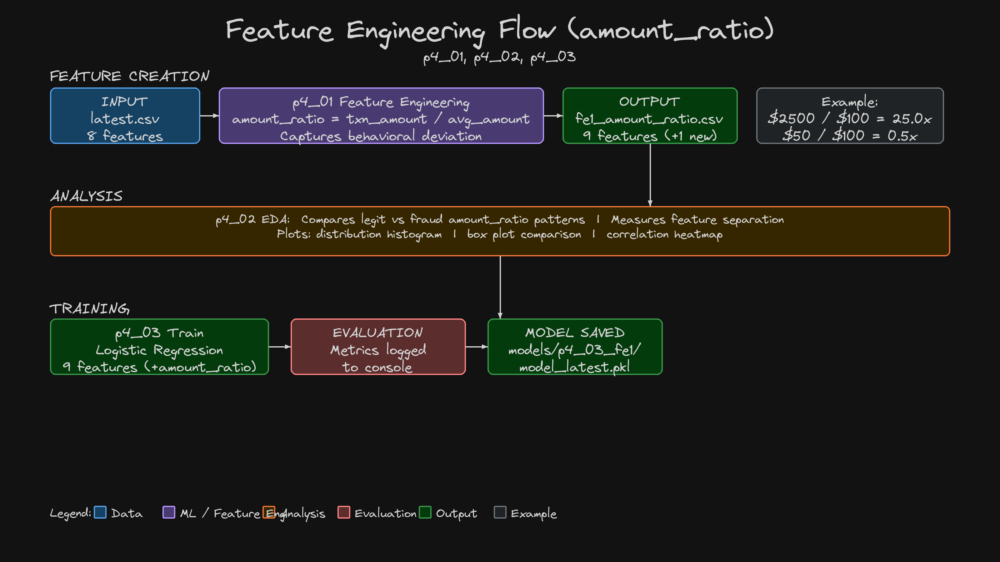
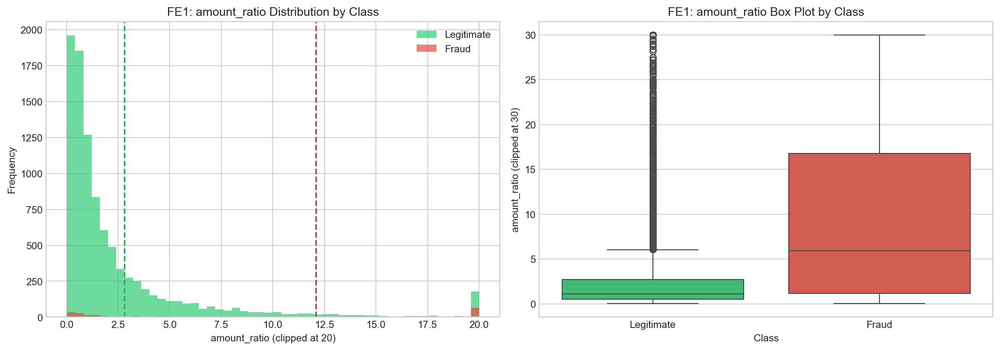
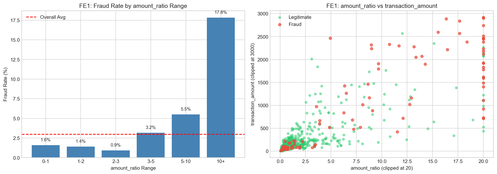
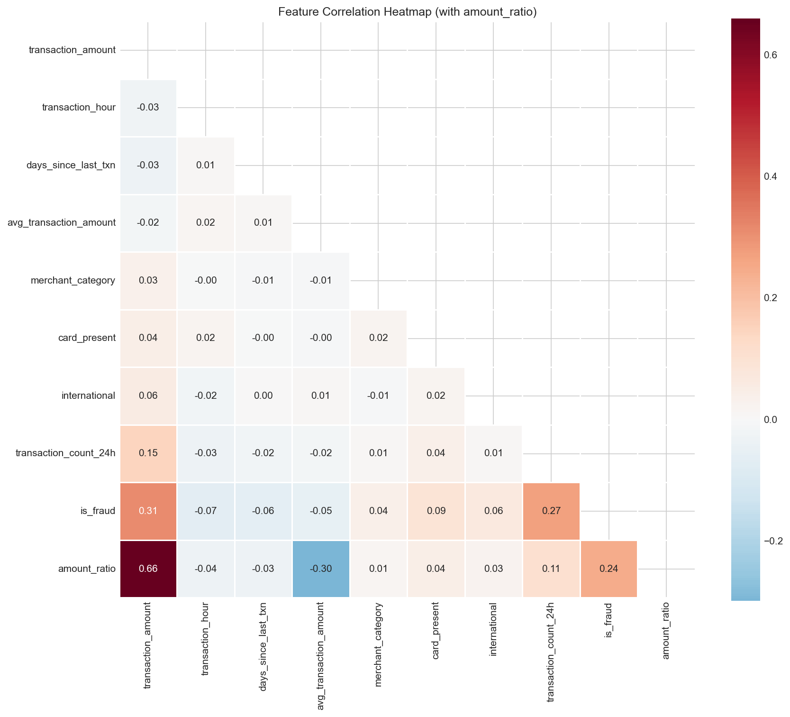

# 06 - Feature Engineering

Feature engineering creates new variables that help the model detect patterns more effectively. This section introduces `amount_ratio`, a feature that captures how much a transaction deviates from the customer's normal spending pattern. Fraudsters typically spend far more than the victim's historical average, making this ratio a potential fraud indicator.

## What is Feature Engineering?

[](../images/05-00-02-WhatIsFeatureEngineering.png)

We go from 8 input features (baseline) to 9 input features by adding `amount_ratio`. The diagram above shows the before/after comparison and how `amount_ratio` is calculated: `transaction_amount / avg_transaction_amount`. A legitimate transaction gives a ratio near 1.0x (normal spending), while a fraud transaction gives 25x (suspicious).

## ML and CCFD Workflow


## Architecture



## Table of Contents

| Step | Topic |
|------|-------|
| Step-01 | [Understand the amount_ratio Feature](#step-01-understand-the-amount_ratio-feature) |
| Step-02 | [Create the Feature](#step-02-create-the-feature) |
| Step-03 | [Analyze the Feature](#step-03-analyze-the-feature) |
| Step-04 | [Train Model with amount_ratio](#step-04-train-model-with-amount_ratio) |
| Step-05 | [Compare Results](#step-05-compare-results---baseline-vs-feature-engineered) |


## Pre-requisite: Python Environment Setup

```bash
# Create conda environment
conda create -n mlops-env1 python=3.14 -c conda-forge -y

# Activate environment
conda activate mlops-env1

# Install dependencies (locked versions)
cd ccfd-project
pip install -r requirements.txt
```

> **Note:** All sections in this course use the same `mlops-env1` environment. You only need to create it once. After that, just activate it with `conda activate mlops-env1` before running any scripts.

---

## Step-01: Understand the amount_ratio Feature

### Formula

```
amount_ratio = transaction_amount / avg_transaction_amount
```

### Why This Matters for Fraud Detection

- A customer with avg spending of $100 making a $50 purchase → ratio = 0.5 (normal)
- Same customer making a $2,500 purchase → ratio = 25.0 (suspicious!)
- Fraudsters don't know the victim's spending patterns, so they tend to spend much more than normal

### Example Calculations

| Customer | Avg Spend | Transaction | amount_ratio | Interpretation |
|----------|-----------|-------------|--------------|----------------|
| Alice | $100 | $50 | 0.5 | Half normal spending |
| Alice | $100 | $100 | 1.0 | Normal spending |
| Alice | $100 | $2,500 | 25.0 | 25x normal - suspicious! |
| Bob | $500 | $600 | 1.2 | Slightly above normal |
| Bob | $500 | $3,000 | 6.0 | 6x normal - suspicious! |

---

## Step-02: Create the Feature

> **Prerequisite:** Each section has its own `ccfd-project/` folder. You must generate data first before running feature engineering.

| File | Description |
|------|-------------|
| `ccfd-project/p4_01_feature_engineering_fe1.py` | Creates amount_ratio and saves new dataset |

```bash
cd 06_Feature_Engineering/ccfd-project
python p1_01_generate_initial_dataset.py    # Generate data (required first)
python p4_01_feature_engineering_fe1.py     # Create amount_ratio feature
```

> **Alternative:** If you're using the shared folder, run all commands from `ccfd-project-main/` instead. See [Shared Project Folder](../README.md#shared-project-folder-alternative) in the root README.

**Expected Output:**
```
======================================================================
FEATURE ENGINEERING: Creating amount_ratio Feature
======================================================================

----------------------------------------------------------------------
STEP 1: Loading Raw Data
----------------------------------------------------------------------
Loaded 10,000 transactions (9 columns)

----------------------------------------------------------------------
STEP 2: Applying Feature Engineering
----------------------------------------------------------------------
Added: amount_ratio (9 total features)
Saved: data/credit_card_transactions_fe1_amount_ratio.csv

----------------------------------------------------------------------
STEP 3: Verifying Results
----------------------------------------------------------------------
Raw columns: 9 → FE columns: 10
New feature added: amount_ratio

======================================================================
FEATURE ENGINEERING COMPLETE!
======================================================================

   Output: data/credit_card_transactions_fe1_amount_ratio.csv
```

---

## Step-03: Analyze the Feature

| File | Description |
|------|-------------|
| `ccfd-project/p4_02_eda_amount_ratio_fe1.py` | Analyzes amount_ratio distribution and correlation |

```bash
python p4_02_eda_amount_ratio_fe1.py
```

**Expected Output:**
```
======================================================================
EDA FOR FEATURE ENGINEERING 1: AMOUNT RATIO
======================================================================

======================================================================
SECTION 2: DISTRIBUTION ANALYSIS
======================================================================

   Legitimate mean: 2.81
   Fraud mean:      12.10
   Difference:      9.29   GOOD separation!
   Saved: eda_plots/07_fe1_amount_ratio_distribution.png

======================================================================
SECTION 3: CORRELATION COMPARISON
======================================================================

   transaction_amount correlation: 0.3111
   amount_ratio correlation:       0.2415
   Saved: eda_plots/08_fe1_amount_ratio_fraud_comparison.png
   Saved: eda_plots/09_fe1_amount_ratio_correlation.png

======================================================================
FE1 EDA COMPLETE!
======================================================================
```

### Feature Analysis Results

| Metric | Legitimate | Fraud | Difference |
|--------|------------|-------|------------|
| **amount_ratio mean** | 2.81 | 12.10 | +9.29 |
| Interpretation | ~3x normal spend | ~12x normal spend | Fraudsters spend 4x more relative to victim's average |

### Generated Plots

| File | Description |
|------|-------------|
| `eda_plots/07_fe1_amount_ratio_distribution.png` | Distribution comparison: legit vs fraud |
| `eda_plots/08_fe1_amount_ratio_fraud_comparison.png` | Fraud rate by range + scatter plot |
| `eda_plots/09_fe1_amount_ratio_correlation.png` | Updated correlation heatmap |

### amount_ratio Distribution (Legit vs Fraud)



### Fraud Rate by amount_ratio Range



### Updated Correlation Heatmap (with amount_ratio)



---

## Step-04: Train Model with amount_ratio

| File | Description |
|------|-------------|
| `ccfd-project/p4_03_train_model_with_fe1.py` | Trains Logistic Regression with 9 features (includes amount_ratio) |

```bash
python p4_03_train_model_with_fe1.py
```

**Expected Output:**
```
======================================================================
Logistic Regression (FE1: amount_ratio) - PERFORMANCE METRICS
======================================================================

TECHNICAL METRICS:
   • F1 Score:     0.2347
   • Precision:    0.1386
   • Recall:       0.7667
   • ROC AUC:      0.8837

BUSINESS METRICS:
   • Net Benefit:    $39,700
   • Fraud Caught:   46
   • Fraud Missed:   14
   • False Alarms:   286

======================================================================
TRAINING SUMMARY
======================================================================

   Model: Logistic Regression (FE1)
   Features: 9 (includes amount_ratio)

   F1 Score: 0.2347
   Net Benefit: $39,700

======================================================================
FE1 TRAINING COMPLETE!
======================================================================
```

---

## Step-05: Compare Results - Baseline vs Feature Engineered

| Metric | Baseline (p3_01) | With FE1 (p4_03) | Change |
|--------|------------------|------------------|--------|
| F1 Score | 0.2329 | 0.2347 | +0.8% |
| Precision | 0.1373 | 0.1386 | +0.9% |
| Recall | 0.7667 | 0.7667 | 0% |
| **Net Benefit** | **$39,625** | **$39,700** | **+$75** |
| False Alarms | 289 | 286 | -3 |

### Why Minimal Improvement?

The improvement is minimal (+$75) because:

1. **Logistic Regression already captures amount patterns** - The raw `transaction_amount` feature already has strong predictive power (+0.31 correlation)
2. **amount_ratio provides redundant information** - Since it's derived from `transaction_amount` and `avg_transaction_amount`, Logistic Regression can learn similar patterns from the raw features
3. **More value comes from hyperparameter tuning** - Section 07 shows that threshold optimization provides much larger improvements than feature engineering alone
4. **Small dataset (10,000 synthetic transactions)** - Real production fraud systems process millions of transactions per day. With only 60 fraud cases in our test set, small improvements from a single engineered feature get lost in statistical noise. At production scale, even a 0.5% lift translates to substantial business value (millions of transactions x ~$1,500 average fraud loss prevented).
5. **Limited feature space (8 base features, 1 engineered)** - Real-world fraud systems use 100+ input features (device fingerprint, IP velocity, merchant risk scores, transaction sequences, user behavior history) and typically ship 10-20+ engineered features over months of iteration. Our `amount_ratio` is illustrative of the technique, not representative of what production feature engineering looks like end-to-end.

---

## Next Steps

| Next | Topic | What You'll Do |
|------|-------|---------------|
| [07_Hyperparameter_Tuning](../07_Hyperparameter_Tuning/) | Optimize Parameters | Search for best parameters, optimize threshold, train final model |
