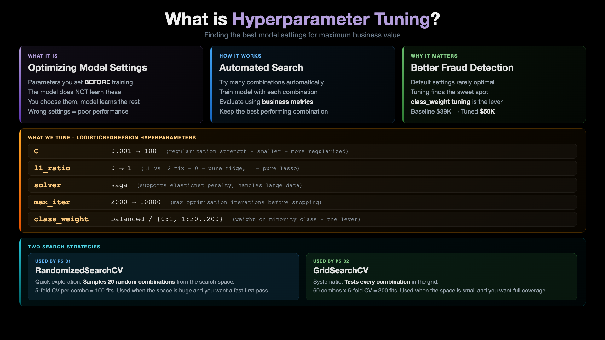
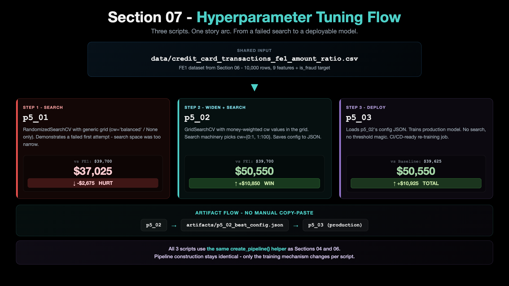
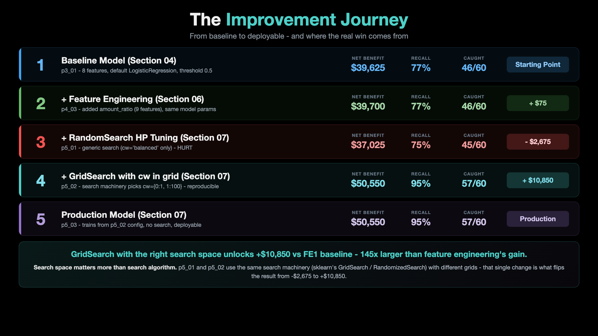
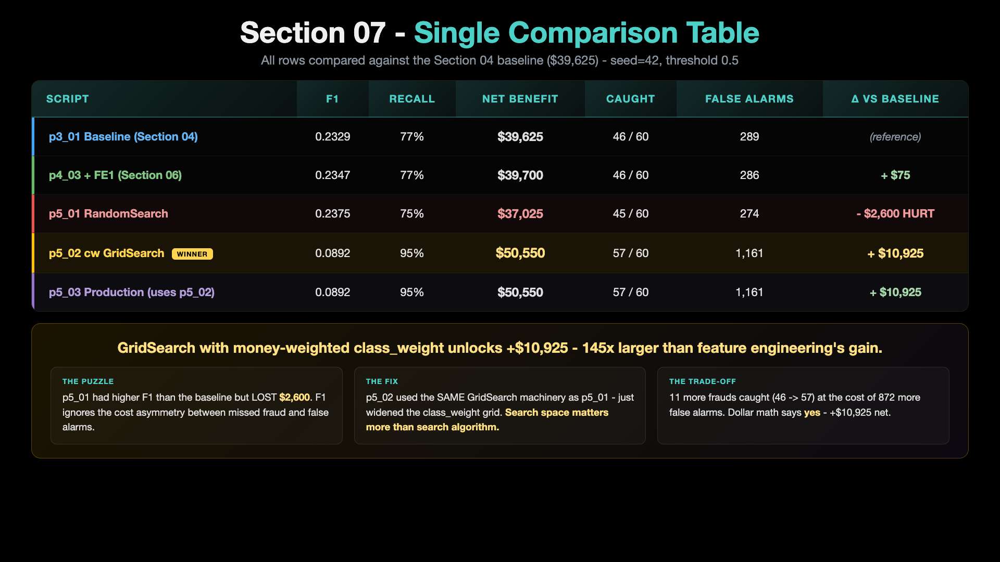

# 07 - Hyperparameter Tuning

The headline insight from this section: **a generic hyperparameter search misses the win.** The actual lever is **`class_weight` aligned with the dollar economics of fraud detection.** Once we widen the GridSearch grid to include money-weighted `class_weight` values, the standard search machinery picks them up and lands at +$10,925 over the baseline.

## Key Concept: What is Hyperparameter Tuning?

[](../images/07-00-01-WhatIsHyperparameterTuning.png)

## Architecture: Section 07 Flow



## The Improvement Journey

[](../images/07-00-03-ImprovementJourney.png)

## Single Comparison Table

[](../images/07-00-04-ComparisonTable.png)

---

## The 3-Script Story Arc

Section 07 is one folder with three `p5_*` scripts. Each script has its OWN README explaining what it does, how to run it, and what output to expect. Click into any of them:

| # | Script | README | Role |
|--:|---|---|---|
| 1 | `p5_01_train_hyperparameter_tuning.py` | **[p5_01_readme.md](./p5_01_readme.md)** | First-pass HP search with `RandomizedSearchCV`. Generic search space (`cw: ['balanced', None]`). Typically does NOT beat FE1. Sets up the puzzle. |
| 2 | `p5_02_class_weight_gridsearch.py` | **[p5_02_readme.md](./p5_02_readme.md)** | `GridSearchCV` with money-weighted `class_weight` in the grid. The standard search machinery finds the winning combo. Produces the production-ready config YAML (`artifacts/p5_02_best_config.yaml`). |
| 3 | `p5_03_train_production_model.py` | **[p5_03_readme.md](./p5_03_readme.md)** | Loads `p5_02`'s config YAML. Trains the deployable production model. No search. |

---

## The Single Comparison Table

All 3 scripts compared, plus baseline + FE1 anchor rows. Same data (FE1 CSV), seed=42, default threshold 0.5.

| Script | What it does | F1 | Precision | Recall | Net Benefit | Caught | Missed | False Alarms | Δ vs FE1 ($39,700) |
|---|---|---:|---:|---:|---:|---:|---:|---:|---:|
| **p3_01 baseline** *(S04)* | 8 features, class_weight='balanced', t=0.5 | 0.2329 | 0.137 | 0.767 | $39,625 | 46/60 | 14 | 289 | -$75 |
| **p4_03 FE1** *(S06)* | + amount_ratio (9 features) | 0.2347 | 0.139 | 0.767 | $39,700 | 46/60 | 14 | 286 | (baseline) |
| **[p5_01](./p5_01_readme.md)** RandomSearch | generic search, cw='balanced' | 0.2375 | 0.141 | 0.750 | **$37,025** | 45/60 | 15 | 274 | **-$2,675 (HURT)** |
| **[p5_02](./p5_02_readme.md)** cw GridSearch | GridSearch picks cw={0:1, 1:100} | 0.0892 | 0.047 | 0.950 | **$50,550** | 57/60 | 3 | 1,161 | **+$10,850** |
| **[p5_03](./p5_03_readme.md)** production | trains from p5_02's config YAML | 0.0892 | 0.047 | 0.950 | **$50,550** | 57/60 | 3 | 1,161 | **+$10,850** |

*Reference numbers from a seed=42 run. Pattern is stable across runs.*

### Reading the table

- **p5_01 HURT** the model - generic search space missed the right `class_weight` values
- **p5_02 was the WIN** - widening the GridSearch grid to include money-weighted `class_weight` lands at +$10,850
- **p5_03 is the deployable** - loads p5_02's config from YAML, trains, saves. CI/CD-friendly.

The lesson is **search space matters more than search algorithm.** `p5_01` and `p5_02` use exactly the same `GridSearchCV` / `RandomizedSearchCV` machinery - the difference is what values they were allowed to try.

---

## Pre-requisite: Python Environment Setup

```bash
# Create conda environment (only once)
conda create -n mlops-env1 python=3.14 -c conda-forge -y

# Activate environment
conda activate mlops-env1

# Install dependencies
cd ccfd-project
pip install -r requirements.txt
```

> All sections in this course use the same `mlops-env1` environment. You only need to create it once.

---

## How to Run All 3 Scripts (in order)

```bash
# Make sure mlops-env1 is active
conda activate mlops-env1

cd 07_Hyperparameter_Tuning/ccfd-project

# One-time data setup (skip if data/ + fe1 CSV already exist)
python p1_01_generate_initial_dataset.py
python p4_01_feature_engineering_fe1.py

# The 3 p5 scripts - each one's README has details
python p5_01_train_hyperparameter_tuning.py      # ~half a minute to a few minutes
python p5_02_class_weight_gridsearch.py           # ~1-3 minutes (saves config for p5_03)
python p5_03_train_production_model.py            # ~3 seconds (loads p5_02 config + trains)
```

---

## Next Steps

After Section 07 you have a tuned production model saved at `models/p5_03_production/`. Section 08 uses this model to serve predictions via a FastAPI endpoint (`p5_04`) and compare against the baseline inference API from Section 04. Two test clients (`p3_03` for the baseline API on port 8000, `p5_05` for the tuned API on port 8001) send the same payload so you can watch the same request produce different decisions in real time.
