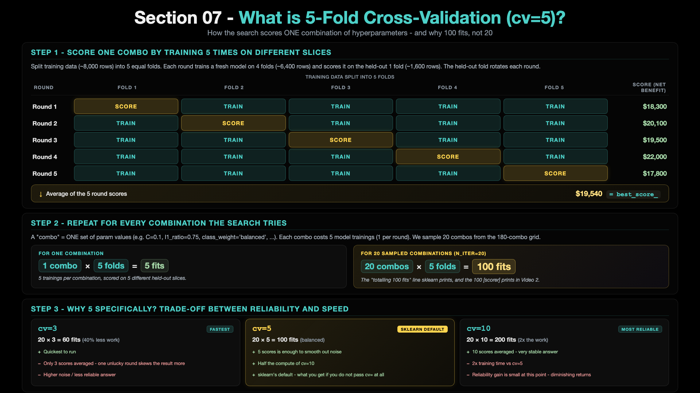
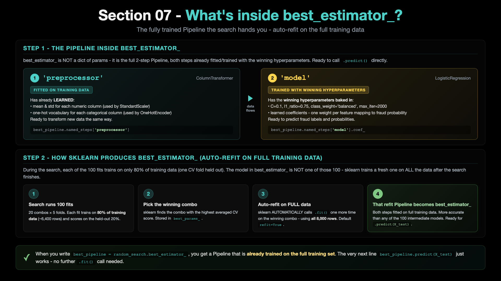

# p5_01 - First-Pass Hyperparameter Tuning (RandomizedSearchCV)

> **Step 1 of 3.** Run a generic `RandomizedSearchCV` over Logistic Regression hyperparameters. Demonstrates that a textbook-default search space (with `class_weight: ['balanced', None]` only) typically does NOT beat the FE1 baseline. Sets up the puzzle that `p5_02` solves.

---

## 1. What we are going to do?

We hand-picked one set of hyperparameters back in `p4_03` (Section 06) and trained a model. The natural next question: are those the BEST hyperparameters? Or could the search machinery find something better?

This script answers that question the way most ML tutorials would teach it:
- Define a "reasonable" hyperparameter search space (`C`, `l1_ratio`, `solver`, `max_iter`, `class_weight`)
- Let `RandomizedSearchCV` sample 20 random combinations
- 5-fold cross-validation scores each combination using a custom Net Benefit scorer
- Pick the winning combination and evaluate it on the test set
- Compare the result to the FE1 baseline

The honest outcome: **the generic search HURTS Net Benefit by ~$2,675 vs FE1.** That is not a bug. It is the puzzle. `p5_02` shows the fix.

---

## 2. What exactly is it?

`RandomizedSearchCV` is sklearn's randomized hyperparameter search machinery. Given an estimator and a parameter distribution, it:

1. Samples `n_iter` random combinations from the parameter distribution
2. For each combination, fits the estimator `cv` times (cross-validation folds)
3. Scores each fit using the provided scorer
4. Picks the combination with the highest average CV score

### The 5-fold cross-validation mechanic (what `cv=5` actually does)



Each combination of hyperparameters is trained 5 times - each round holds out a different fold as the score slice. The 5 round scores are averaged → that average is the combination's `best_score_`. Then multiply by `n_iter=20` random combos → **100 fits total** in this script. `cv=5` is sklearn's default - the sweet spot between reliability (more folds smooth out noise) and speed (fewer folds run faster).

### Why it fails on our problem

The search space includes only `class_weight: ['balanced', None]`. `'balanced'` uses inverse class frequencies (~`{0: 0.5, 1: 16}` for our ~3% fraud rate, a 32:1 penalty ratio). But the dollar cost ratio is `$1,500 fraud / $25 false alarm = 60:1`. So `'balanced'` is under-weighting fraud relative to the dollar reality. The search picks combinations that look good by F-1-ish metrics but lose money. We will fix this in `p5_02` by widening the `class_weight` grid to include aggressive money-weighted dictionaries like `{0:1, 1:100}`.

**Key code blocks in the script:**

- `business_value_scorer(y_true, y_pred)` - 3-line custom scorer that returns `calculate_business_metrics(...)['net_benefit']`. Wrapped via `make_scorer(..., greater_is_better=True)` so the search optimises dollars, not F1.
- `param_distributions = {...}` - the search space (180 combinations possible)
- `RandomizedSearchCV(estimator=pipeline, ..., n_iter=20, cv=5, scoring=business_scorer, n_jobs=-1, random_state=42)` - the search machinery
- `random_search.fit(X_train, y_train)` - runs 20 combinations x 5 folds = 100 model fits

---

## 3. How to run it

### Step 1 - make sure you are in the `mlops-env1` conda environment

```bash
# Check what conda environment you are currently in
conda info --envs
# Look for the asterisk (*) - that marks the active env. If it is not on
# mlops-env1, switch:

conda deactivate          # only needed if you are in a different env
conda activate mlops-env1
```

If `mlops-env1` does not exist yet (first time on this machine), see the **Pre-requisite** section in the [section README](./README.md).

### Step 2 - go to the project folder

```bash
cd 07_Hyperparameter_Tuning/ccfd-project
```

### Step 3 - make sure data + FE1 CSV exist

```bash
# Only needed if you have not generated them yet (one-time setup)
python p1_01_generate_initial_dataset.py
python p4_01_feature_engineering_fe1.py
```

### Step 4 - run this script

```bash
python p5_01_train_hyperparameter_tuning.py
```

Runtime: roughly half a minute to a few minutes depending on your CPU.

---

## 4. What is the result output?

The script prints, in order:

- Header banner: `p5_01 - HYPERPARAMETER TUNING (RandomizedSearchCV)`
- STEP 1-3: load FE1 CSV, split data, create Pipeline (via `create_pipeline()` helper, same as p3_01/p4_03)
- STEP 4: define the custom Business-Value scorer (the function and `make_scorer` wrapping)
- STEP 5: search-space + sampling plan banner, then sklearn's progress lines:

```
The Space:  6 C  x  5 l1_ratio  x  1 solver  x  3 max_iter  x  2 class_weight  =  180 combinations
  -> class_weight = ['balanced', None] only  -  this is the NARROW part
The Plan:   pick 20 of those 180 randomly  (RandomizedSearchCV)
The Work:   each of the 20 picks gets 5-fold cross-validation
            20 x 5 = 100 training jobs

verbose=2 below - you will see one line per fit as the search runs.

Fitting 5 folds for each of 20 candidates, totalling 100 fits
```
- STEP 6: the winning hyperparameter combination + extracted pipeline

```
STEP 6: Best Parameters Found

BEST PARAMETERS:
  solver: saga
  max_iter: 2000
  l1_ratio: 0.75
  class_weight: balanced
  C: 0.1

Best CV Net Benefit: $20,900
  - averaged across the 5 CV folds (each scored on ~12 frauds = low absolute value)
  - this is a RANKING signal for the search, not the number you would ship to production
  - the real test-set Net Benefit appears in STEP 7 (and will be higher)
```

> **Note:** each CV fold has about **48 frauds** (238 training frauds / 5 folds), not ~12. The script's print says ~12 by mistake; the numbers it shows are right.

### What you actually get back from the search - `best_estimator_`



After `random_search.fit(...)` finishes, `random_search.best_estimator_` is the complete 2-step Pipeline (preprocessor + model) already FITTED and TRAINED with the winning hyperparameters - and **trained on the FULL training set**, not just one CV fold. sklearn auto-refits on full data via the `refit=True` default. So `best_pipeline.predict(X_test)` just works - no further `.fit()` needed.

- STEP 7: test-set evaluation block with all technical + business metrics
- STEP 8: save model + metadata + metrics JSON
- Closing **IMPROVEMENT JOURNEY** block:

```
IMPROVEMENT JOURNEY SO FAR
======================================================================

 Stage 1 - Baseline (p3_01, no FE):           F1=0.2329   Net Benefit=$39,625
 Stage 2 - + FE1 (p4_03, + amount_ratio):     F1=0.2347   Net Benefit=$39,700   (+$75 vs Stage 1)
 Stage 3 - + RandomSearch (p5_01):            F1=0.2375   Net Benefit=$37,025   ($-2,675 vs Stage 2)

 Total change vs Stage 1 baseline:            $-2,600

 RandomSearch did NOT improve on FE1 - lost $2,675.
 The search space here is too narrow on class_weight.
 p5_02 will show the fix.

 Run next: python p5_02_class_weight_gridsearch.py
```

---

## 5. Complete metrics table

| Metric | Value | Note |
|---|---:|---|
| **F1 Score** | 0.2375 | slightly up vs FE1 (0.2347) |
| **Precision** | 0.1411 | TP / (TP + FP) = 45 / 319 |
| **Recall** | 0.7500 | TP / (TP + FN) = 45 / 60 |
| **ROC AUC** | 0.8851 | unchanged - threshold-independent |
| **Net Benefit** | **$37,025** | DOWN $2,675 vs FE1 ($39,700) |
| **Fraud Caught (TP)** | 45 / 60 | one fewer than FE1 |
| **Fraud Missed (FN)** | 15 | one more than FE1 |
| **False Alarms (FP)** | 274 | fewer than FE1 (286) |
| **True Negatives (TN)** | 1,666 | |

**Best params picked by the search:** `solver=saga`, `max_iter=2000`, `l1_ratio=0.75`, `class_weight='balanced'`, `C=0.1`

**Output artifacts:**
- `models/p5_01_randomsearch/model_latest.pkl`
- `models/p5_01_randomsearch/metadata_latest.json`
- `results/logistic_regression_p5_01_randomsearch_*.json`

---

## Where this fits in Section 07

This is the **first** of 3 scripts. See the [section README](./README.md) for the full 3-script arc and the comparison table. The next script - [`p5_02`](./p5_02_readme.md) - shows why the search failed here and what to do about it.
