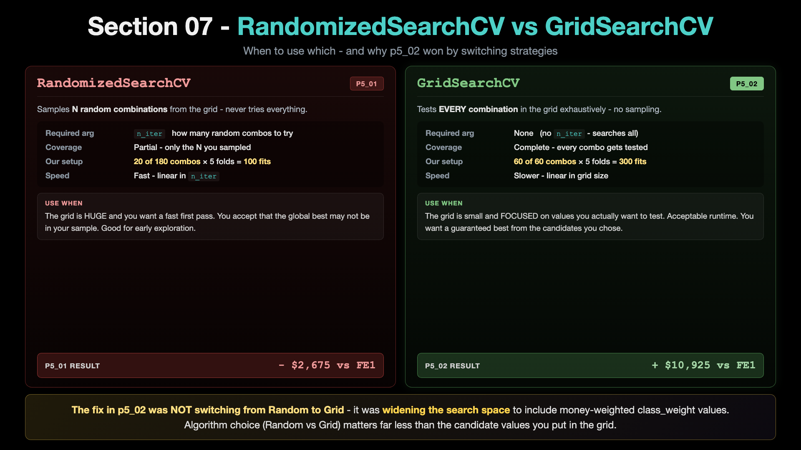
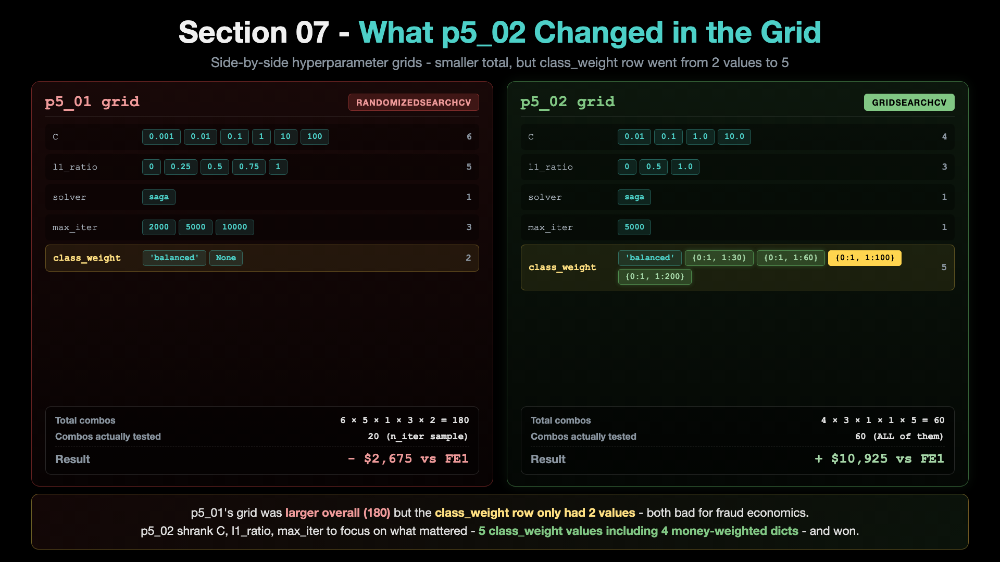
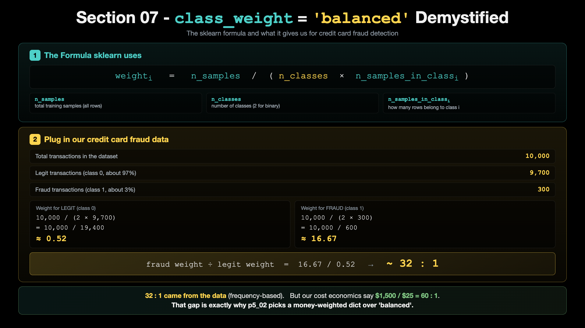
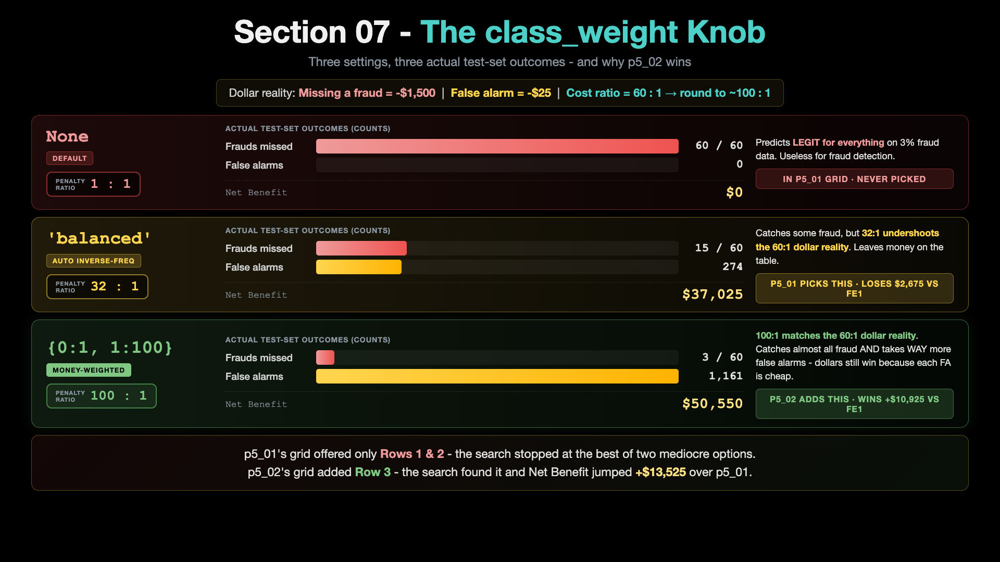
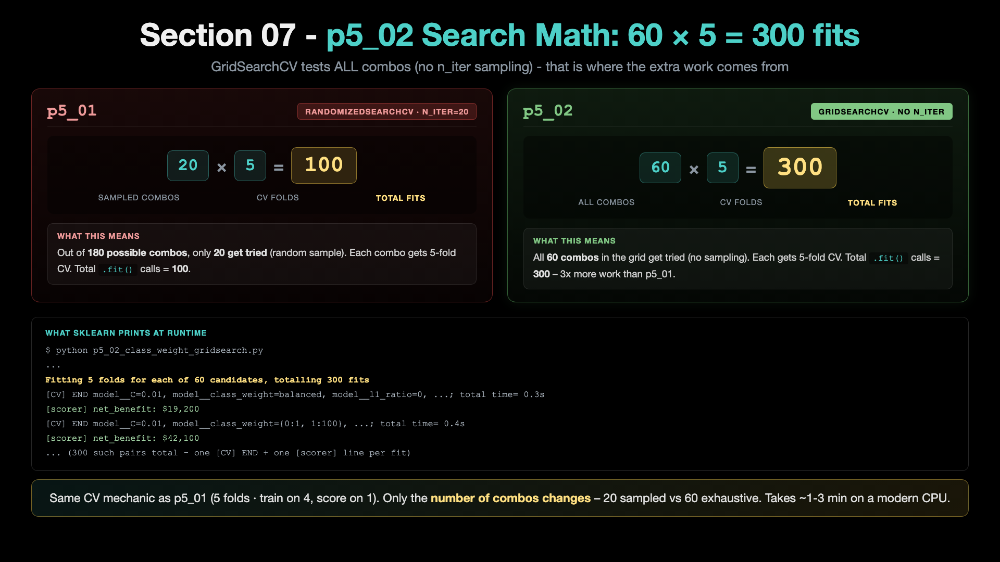

# p5_02 - GridSearchCV with money-weighted class_weight

> **Step 2 of 3.** `p5_01`'s Random search lost money - the search space was too narrow on `class_weight`. This script does a proper `GridSearchCV` with an expanded grid that includes money-weighted `class_weight` values like `{0:1, 1:30}` ... `{0:1, 1:200}`. The grid picks `class_weight={0:1, 1:100}` and produces Net Benefit **$50,550** - **+$10,925** over the baseline. Saves the winning config for `p5_03` (production) to consume.

---

## 1. What we are going to do?

`p5_01` showed that a generic hyperparameter search can actually HURT - it lost $2,675 versus the FE1 baseline. The miss was the search space itself: it only tried `class_weight=['balanced', None]`, which were not aggressive enough for the cost asymmetry in fraud detection.

This script switches the algorithm from `RandomizedSearchCV` (what p5_01 used) to `GridSearchCV`, AND - more importantly - widens the grid to include money-weighted `class_weight` values. The search:

1. Fits the pipeline (preprocessing + LogisticRegression) on `X_train`, `y_train`
2. Scores each combo by **net business value** (custom `make_scorer`), not by F1 or accuracy
3. Uses 5-fold cross-validation
4. Reports the winning combo

The winning config is saved to `artifacts/p5_02_best_config.yaml` so `p5_03` (production training) can read it without any manual copy-paste between scripts.

### Algorithm shift: RandomizedSearchCV → GridSearchCV



`RandomizedSearchCV` samples N random combos from a grid (you set `n_iter`); `GridSearchCV` tests ALL combos exhaustively. p5_01 used Random because the grid was 180 combos and we did a fast first pass with `n_iter=20`. p5_02 uses Grid because we've now narrowed the grid down to 60 focused combos - small enough to test exhaustively, and exhaustive testing gives a deterministic winner. **But the bigger lesson:** algorithm choice (Random vs Grid) is secondary. What unlocked the win was widening the class_weight grid - see the punchline image below.

---

## 2. What exactly is it?

A standard `GridSearchCV` driver. Notable code blocks:

- The search grid expands `p5_01`'s narrow `class_weight` list to include `['balanced', {0:1, 1:30}, {0:1, 1:60}, {0:1, 1:100}, {0:1, 1:200}]`. Full grid is `C: [0.01, 0.1, 1.0, 10.0]`, `l1_ratio: [0, 0.5, 1.0]`, `solver: ['saga']`, `max_iter: [5000]`, plus the 5 `class_weight` values
- `business_scorer = make_scorer(business_value_scorer, greater_is_better=True)` - business metric in the loop, not F1 (same scorer pattern as p5_01)
- `grid_search = GridSearchCV(pipeline, param_grid, scoring=business_scorer, cv=5, n_jobs=-1, verbose=2)` - grid is 4 C x 3 l1_ratio x 5 cw = 60 combos x 5-fold CV = 300 fits
- `grid_search.fit(X_train, y_train)` - typically runs in ~1-3 minutes
- The winning combo is printed and saved as YAML

### The grid expansion (what specifically changed vs p5_01)



p5_01's grid had `class_weight=['balanced', None]` (2 values, both bad for the dollar economics). p5_02 keeps 'balanced' but **adds 4 money-weighted dicts** - including `{0:1, 1:100}` which matches the 60:1 cost ratio (rounded up). p5_02 also trimmed C, l1_ratio, max_iter ranges to keep the grid focused on what matters. Net effect: smaller TOTAL grid (60 vs 180 in p5_01) but the WINNING value is now IN the grid.

### Where `class_weight='balanced'` actually comes from (the 32:1 derivation)

In Sections 04 and 06 we used `class_weight='balanced'` in every training script (`p3_01`, `p4_03`) and promised to explain WHERE that 32:1 ratio actually comes from when we got to Hyperparameter Tuning. Here is the answer.



The top half is the sklearn formula: `weight_i = n_samples / (n_classes × n_samples_in_class_i)`. The bottom half plugs in our actual data (10,000 transactions, 9,700 legit, 300 fraud) and computes the two class weights - about 0.52 for legit, about 16.67 for fraud. Divide one by the other and you get the 32:1 ratio.

That 32 is not a choice we made. It comes directly from the class frequencies in the training data. If our fraud rate were 1%, the ratio would jump to about 100. If our fraud rate were 10%, it would drop to about 10. The number is a function of the dataset, not a hyperparameter we tune.

**The catch:** 32:1 matches the FREQUENCY asymmetry of fraud vs legit. But our cost economics say `$1,500 / $25 = 60:1`. The two numbers do not agree. That gap is exactly why p5_02 picks a money-weighted dict over 'balanced' - we want to match the COST asymmetry, not the frequency one.

### Why money-weighted class_weight wins (THE punchline of Section 07)



`class_weight=None` gives a 1:1 penalty ratio (model predicts LEGIT for everything, useless). `class_weight='balanced'` gives a 32:1 ratio (better but undershoots the dollar reality - see the formula image above). `class_weight={0:1, 1:100}` gives a 100:1 ratio that MATCHES the actual cost economics (missing fraud $1,500 vs false alarm $25 = 60:1, rounded to 100). p5_01's grid had Rows 1 and 2 only - it lost. p5_02's grid adds Row 3 - it wins.

### The 300 fits math



GridSearchCV with our 60-combo grid runs `60 × 5 = 300` model fits (no n_iter to limit it - it tests everything). That is 3x more work than p5_01's 100 fits, but only 60 unique combos (vs p5_01's 180 unique combos with 20 sampled randomly). The takeaway: GridSearch trades MORE work per combo for COMPLETE coverage of a SMALLER focused grid.

### Why this matters for the section's narrative

`p5_01` showed "generic HP search fails." `p5_02` shows "armed with the right search space, the standard search machinery succeeds." This is the actual lesson - **search space matters more than search algorithm.**

### Output artifact for p5_03

The script saves `artifacts/p5_02_best_config.yaml` with the full best params and the test-set Net Benefit. `p5_03` reads this file and trains the production model from it. No manual copy-paste from console output to source code.

YAML is the format for this artifact because `class_weight={0:1, 1:100}` is a dict with integer keys, and YAML stores int keys natively - the dict round-trips between `p5_02` and `p5_03` exactly as sklearn expects it.

---

## 3. How to run it

### Step 1 - make sure you are in the `mlops-env1` conda environment

```bash
conda info --envs
# If active env is not mlops-env1:
conda deactivate
conda activate mlops-env1
```

### Step 2 - go to the project folder

```bash
cd 07_Hyperparameter_Tuning/ccfd-project
```

### Step 3 - make sure data + FE1 CSV exist

```bash
python p1_01_generate_initial_dataset.py            # only if data does not exist
python p4_01_feature_engineering_fe1.py              # only if FE1 CSV does not exist
```

### Step 4 - run this script

```bash
python p5_02_class_weight_gridsearch.py
```

Runtime: ~1-3 minutes depending on machine. `n_jobs=-1` uses all cores.

---

## 4. What is the result output?

The script prints, in order:

- Header banner: `p5_02 - GridSearchCV with money-weighted class_weight`
- STEP 1: data load
- STEP 2: build Pipeline (same `create_pipeline` helper as p3_01 / p4_03 / p5_01)
- STEP 3: define business-value scorer (dollars, not F1)
- STEP 4: define the search grid (4 C x 3 l1_ratio x 5 cw = 60 combos)
- STEP 5: run GridSearchCV (~1-3 min, prints best params + best CV score)
- STEP 6: test-set evaluation block (full `print_metrics()` output)
- STEP 7: save model + metadata + **save the best config to `artifacts/p5_02_best_config.yaml`**
- Closing **IMPROVEMENT JOURNEY SO FAR** summary:

```
IMPROVEMENT JOURNEY SO FAR
======================================================================

 Stage 1 - Baseline (p3_01, no FE):           Net Benefit=$39,625
 Stage 2 - + FE1 (p4_03, + amount_ratio):     Net Benefit=$39,700
 Stage 3 - + RandomSearch (p5_01):            (failed - too narrow grid)
 Stage 4 - + GridSearch w/ cw (p5_02):        Net Benefit=$50,550   (+$10,850 vs FE1)

 Total change vs Stage 1 baseline:            +$10,925

 p5_02's best config is saved to: artifacts/p5_02_best_config.yaml
 This YAML file is what p5_03 will read to train the production model.

 Run next: python p5_03_train_production_model.py (final deployable model)
```

The winning config looks like:

```python
best_params = {
    'C': 0.1,
    'l1_ratio': 1.0,
    'solver': 'saga',
    'max_iter': 5000,
    'class_weight': {0: 1, 1: 100},
    'random_state': 42,
}
```

---

## 5. Complete metrics table (test set, default threshold 0.5)

| Metric | Value | Note |
|---|---:|---|
| **F1 Score** | 0.0892 | low - precision dropped because we accept many false alarms |
| **Precision** | 0.0468 | TP / (TP + FP) = 57 / 1,218 |
| **Recall** | 0.9500 | TP / (TP + FN) = 57 / 60 |
| **ROC AUC** | 0.8835 | unchanged - threshold-independent |
| **Net Benefit** | **$50,550** | **+$10,925 vs baseline ($39,625)** |
| **Fraud Caught (TP)** | **57 / 60** | catches 11 more than baseline |
| **Fraud Missed (FN)** | 3 | only 3 missed out of 60 |
| **False Alarms (FP)** | 1,161 | high - but $25 each, worth it |
| **True Negatives (TN)** | 779 | |

**Output artifacts:**
- `models/p5_02_class_weight_gridsearch/model_latest.pkl` + metadata
- `results/logistic_regression_p5_02_*.json`
- **`artifacts/p5_02_best_config.yaml`** - consumed by `p5_03`

---

## Where this fits in Section 07

Step 2 of 3. The HP search done properly. See the [section README](./README.md) for the full 3-script arc and the comparison table.

- [`p5_01`](./p5_01_readme.md) - Random search with a too-narrow grid. The puzzle (HP tuning HURTS).
- [`p5_03`](./p5_03_readme.md) - production model trained from THIS script's saved config. The deployable artifact.

After Section 07 you have a tuned production model saved at `models/p5_03_production/`. Section 08 uses this model to serve predictions via a FastAPI endpoint and compare against the baseline inference API from Section 04.
