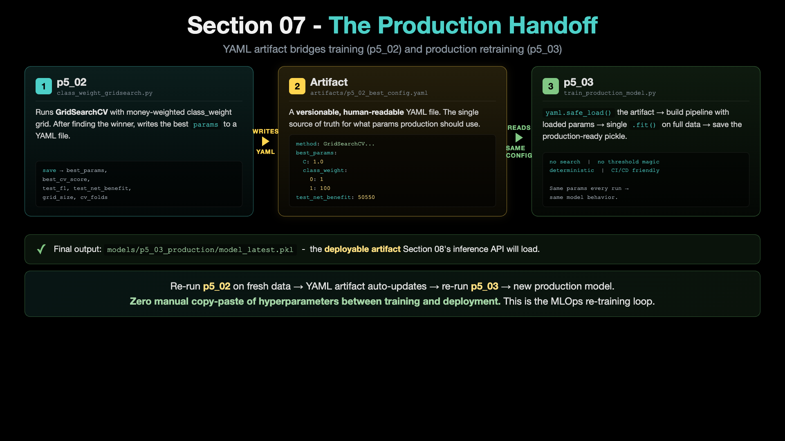

# p5_03 - Train Production Model (deployable)

> **Step 3 of 3 (final).** Load the winning config from `p5_02`'s YAML artifact. Train the final production model. No HP search, no threshold gymnastics. Fast, deterministic, CI/CD-friendly. This is the deployable artifact - the model you ship to inference services.

---

## 1. What we are going to do?

`p5_02` discovered the production-ready hyperparameters via `GridSearchCV` and saved them to `artifacts/p5_02_best_config.yaml`. This script:

1. Reads that YAML config
2. Trains the final production model with those exact hyperparameters
3. Evaluates on the test set
4. Saves the model + metadata to `models/p5_03_production/`

That is it. No search. No tuning. No threshold magic. Just train with the known-good config and save.

### The production handoff pattern



This is the MLOps re-training loop. p5_02 writes `artifacts/p5_02_best_config.yaml` (left box). p5_03 reads that YAML (right box). The model produced (`models/p5_03_production/model_latest.pkl`) is what Section 08's inference API loads. **Re-run p5_02 on fresh data → YAML auto-updates → re-run p5_03 → new production model.** Zero manual copy-paste of hyperparameters between training and deployment.

**Why a separate script?** In real MLOps you re-train your model regularly (daily / weekly) on fresh data. You do NOT re-run hyperparameter search every time - that is expensive and the result barely changes. Instead, you cache the hyperparameters once (`p5_02`), and the re-training job (THIS script) just loads them and trains. Re-running `p5_02` on fresh data updates the artifact, and the next run of this script automatically picks up the new config.

---

## 2. What exactly is it?

The script is purposefully minimal - it does training only. Notable code blocks:

- `with open(INPUT_ARTIFACT) as f: config = yaml.safe_load(f)` - reads the YAML artifact
- `best_params = config['best_params']` - extracts the model params. `class_weight={0:1, 1:100}` arrives as a dict with int keys, ready to hand to sklearn as-is
- `pipeline = create_pipeline(..., model_params=best_params)` - same `create_pipeline()` helper as `p3_01` / `p4_03` / `p5_01-02`
- `pipeline.fit(X_train, y_train)` - one train call, no search wrapping
- `pipeline.predict(X_test)` - default threshold 0.5 (because the aggressiveness is already baked into `class_weight`)
- `save_pipeline(...)` - saves to `models/p5_03_production/`

If `p5_02` has not been run, this script errors with a clear message asking you to run it first.

---

## 3. How to run it

### Step 1 - make sure you are in the `mlops-env1` conda environment

```bash
conda info --envs
# If active env is not mlops-env1:
conda deactivate
conda activate mlops-env1
```

### Step 2 - go to the project folder

```bash
cd 07_Hyperparameter_Tuning/ccfd-project
```

### Step 3 - make sure data + FE1 CSV + p5_02 config exist

```bash
python p1_01_generate_initial_dataset.py            # only if data does not exist
python p4_01_feature_engineering_fe1.py              # only if FE1 CSV does not exist
python p5_02_class_weight_gridsearch.py              # creates artifacts/p5_02_best_config.yaml
```

### Step 4 - run this script

```bash
python p5_03_train_production_model.py
```

Runtime: ~2-3 seconds. Just a single model train + test evaluation + save.

---

## 4. What is the result output?

The script prints, in order:

- Header banner: `p5_03 - TRAIN PRODUCTION MODEL (uses p5_02 winning config)`
- STEP 1: loads `artifacts/p5_02_best_config.yaml` and prints the config

```
Production config (from p5_02):
  C: 0.1
  l1_ratio: 1.0
  solver: saga
  max_iter: 5000
  class_weight: {0: 1, 1: 100}
```

(Note: `random_state` is set internally by `create_pipeline()` for reproducibility - not part of the search grid, so it does not appear in the loaded config.)

### The hyperparameter we inherited from p5_02 - why class_weight={0:1, 1:100} matters


The `class_weight={0:1, 1:100}` value in the config above is the bottom row of this image (the green one). p5_02 picked it from a 5-value grid because it matches the 60:1 dollar cost ratio of fraud detection. p5_03 just trains with that pre-discovered winner - no search, no second-guessing. This is what "deterministic re-training from a cached config" looks like in practice.

- STEP 2: load FE1 CSV + split
- STEP 3: train production model (no search)
- STEP 4: test-set evaluation block (full `print_metrics()` output)
- STEP 5: save model + metadata to `models/p5_03_production/`
- Closing **FULL IMPROVEMENT JOURNEY** summary:

```
FULL IMPROVEMENT JOURNEY (final)
======================================================================

  Stage 1 - Baseline (p3_01, no FE):           $39,625
  Stage 2 - + FE1 (p4_03, amount_ratio):       $39,700   (+$75)
  Stage 3 - + RandomSearch (p5_01):             typically HURT (narrow grid)
  Stage 4 - + GridSearch w/ cw (p5_02):         $50,550   (finds the right params)
  Stage 5 - Production model (p5_03, this):    $50,550

  Total change vs Stage 1 baseline:            +$10,925

  The production model is saved at models/p5_03_production/
  Re-train it any time by re-running p5_02 (updates artifact) then this script.
```

---

## 5. Complete metrics table

For the production model (config inherited from `p5_02`), evaluated at default threshold 0.5:

| Metric | Value | Note |
|---|---:|---|
| **F1 Score** | 0.0892 | low (same trade-off as p5_02) |
| **Precision** | 0.0468 | TP / (TP + FP) = 57 / 1,218 |
| **Recall** | 0.9500 | TP / (TP + FN) = 57 / 60 |
| **ROC AUC** | 0.8835 | unchanged - threshold-independent |
| **Net Benefit** | **$50,550** | **+$10,925 vs baseline ($39,625)** |
| **Fraud Caught (TP)** | **57 / 60** | |
| **Fraud Missed (FN)** | 3 | only 3 missed out of 60 |
| **False Alarms (FP)** | 1,161 | high - but $25 each, worth it |
| **True Negatives (TN)** | 779 | |

**Metrics match `p5_02` exactly** because we use the same config on the same train/test split with the same random seed.

**Output artifacts:**
- `models/p5_03_production/model_latest.pkl` - deployable model
- `models/p5_03_production/metadata_latest.json` - includes `best_params`, `config_source`, `production_role`
- `results/logistic_regression_p5_03_production_*.json`

---

## Where this fits in Section 07

Step 3 of 3. The final deployable. See the [section README](./README.md) for the full 3-script arc and the comparison table.

After this section, you have a tuned production model at `models/p5_03_production/`. Section 08 uses this model to serve predictions via a FastAPI endpoint and compare against the baseline inference API from Section 04.
