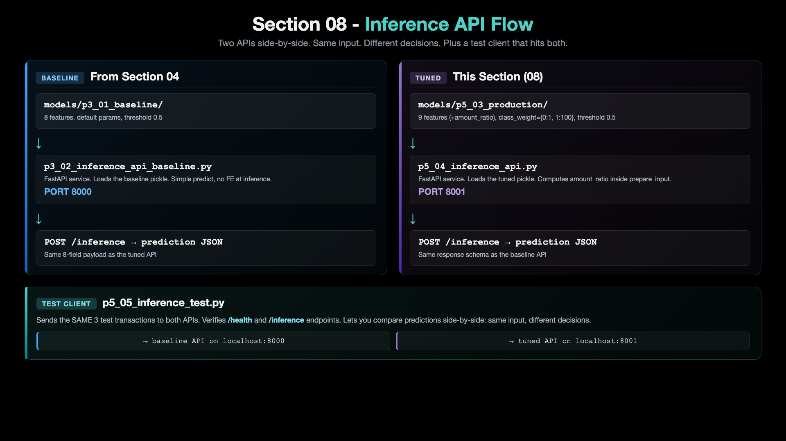
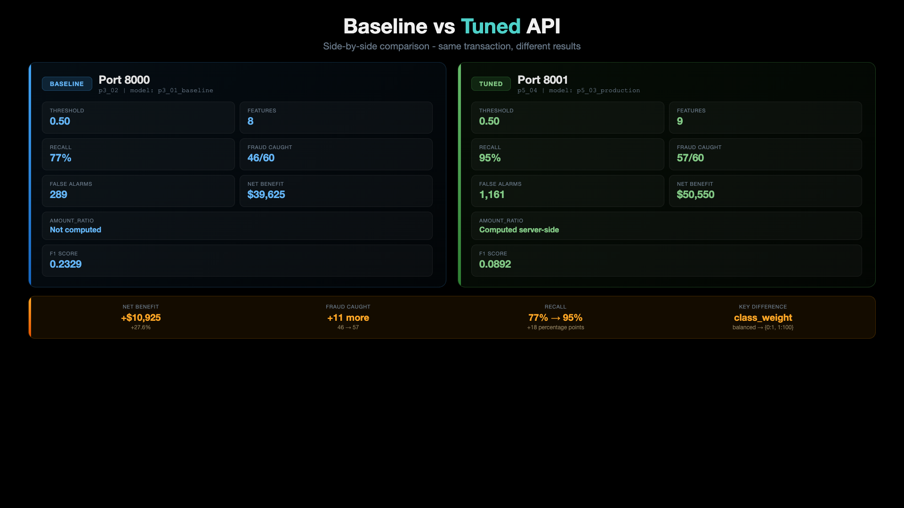

# 08 - Tuned Inference API

Section 07 produced a tuned production model at `models/p5_03_production/`. Section 08 wraps that model in a FastAPI service on port **8001** and stands it next to the baseline API on port **8000**. Same input fields. Different decisions. Visible in real time.

The headline insight from this section: **the same 8-field request that the baseline calls LEGITIMATE, the tuned API calls FRAUD** - and that flip is exactly the +$10,925 Net Benefit we picked up in Section 07, now serving over HTTP.

## Architecture: Section 08 Flow

[](../images/08-00-01-InferenceAPIFlow.png)

## Baseline vs Tuned API

[](../images/08-00-02-BaselineVsTunedAPI.png)

---

## The 2-Script Story Arc

Section 08 is one folder with two new `p5_*` scripts (plus the carry-forward scripts from earlier sections). Each new script has its own README explaining what it does, how to run it, and what output to expect.

| # | Script | README | Role |
|--:|---|---|---|
| 1 | `p5_04_inference_api.py` | **[p5_04_readme.md](./p5_04_readme.md)** | FastAPI service for the tuned production model. Loads `models/p5_03_production/`. Computes `amount_ratio` server-side. Listens on port 8001. |
| 2 | `p5_05_inference_test.py` | **[p5_05_readme.md](./p5_05_readme.md)** | Test client. Sends 3 sample transactions to the tuned API. Verifies `/health` and `/inference`. |

The baseline API (`p3_02_inference_api_baseline.py`) and baseline test client (`p3_03_inference_test_baseline.py`) come along from Section 04 unchanged. You run both APIs in parallel to compare.

---

## The Two APIs Side by Side

| API | Script | Port | Model | Features | class_weight | Threshold |
|---|---|---|---|---|---|---|
| Baseline | `p3_02_inference_api_baseline.py` | **8000** | `p3_01_baseline` | 8 | `'balanced'` | 0.5 |
| **Tuned** | **`p5_04_inference_api.py`** | **8001** | **`p5_03_production`** | **9** | **`{0:1, 1:100}`** | **0.5** |

Two things to notice:

1. **Threshold is 0.5 for both.** The tuned model gets its aggressiveness from `class_weight`, not from a lowered threshold. No threshold magic at predict time.
2. **The tuned API computes `amount_ratio` server-side** from `transaction_amount / avg_transaction_amount`. Same 8 raw input fields hit both APIs.

### Endpoints (identical on both APIs)

| Endpoint | Method | What it does |
|---|---|---|
| `/` | GET | API info |
| `/health` | GET | Health check + model status |
| `/ui` | GET | Browser-based test form |
| `/inference` | POST | Predict on a transaction |
| `/docs` | GET | Swagger UI |

---

## Real Numbers: Baseline vs Tuned (test set, seed=42)

| Metric | Baseline API (8000) | Tuned API (8001) | Delta |
|---|---:|---:|---:|
| F1 Score | 0.2329 | 0.0892 | -0.1437 |
| Recall | 76.7% | 95.0% | +18.3 pts |
| Fraud Caught | 46/60 | 57/60 | +11 |
| False Alarms | 289 | 1,161 | +872 |
| **Net Benefit** | **$39,625** | **$50,550** | **+$10,925 (+27.6%)** |

The tuned model has a worse F1 and 4x more false alarms - but the dollars don't lie. Each caught fraud nets +$1,475 and each missed fraud costs -$1,500, so trading 872 extra $25 false alarms for 11 more caught frauds is the right call. This is the same trade-off Section 07 proved on offline data - now you watch it happen over HTTP.

---

## Pre-requisite: Python Environment Setup

```bash
# Create conda environment (only once)
conda create -n mlops-env1 python=3.14 -c conda-forge -y

# Activate environment
conda activate mlops-env1

# Install dependencies
cd ccfd-project
pip install -r requirements.txt
```

> All sections in this course use the same `mlops-env1` environment. You only need to create it once.

---

## How to Run (full path: train → serve → test)

```bash
# Make sure mlops-env1 is active
conda activate mlops-env1

cd 08_Tuned_Inference_API/ccfd-project

# One-time data + model setup (skip if files already exist)
python p1_01_generate_initial_dataset.py     # generate 10k synthetic transactions
python p4_01_feature_engineering_fe1.py      # add amount_ratio feature
python p3_01_train_model_baseline.py         # train the 8-feature baseline model
python p5_02_class_weight_gridsearch.py      # find best class_weight (saves config YAML)
python p5_03_train_production_model.py       # train production model from the config

# Start both APIs (two terminals)
# Terminal 1: baseline API on port 8000
python p3_02_inference_api_baseline.py

# Terminal 2: tuned API on port 8001
python p5_04_inference_api.py
```

```bash
# Terminal 3: run the test clients
python p3_03_inference_test_baseline.py    # hits port 8000
python p5_05_inference_test.py              # hits port 8001
```

---

## What You Should See

Send the SAME 3 transactions to both APIs. Watch what flips.

| Transaction | Baseline (8000) | Tuned (8001) | What it shows |
|---|---|---|---|
| Normal grocery $50 | 31.61% LEGITIMATE | **60.60% FRAUD** | The tuned model flags a borderline case the baseline misses |
| Suspicious intl $2,500 | 99.75% FRAUD | 99.84% FRAUD | Obvious fraud - both agree, tuned is slightly more confident |
| High-value jewelry $1,500 | 99.31% FRAUD | 99.60% FRAUD | Clear fraud - both agree, tuned is slightly more confident |

The first row is the whole point of this section. The borderline case that the baseline lets through is exactly the kind of fraud the tuned model was built to catch. The cost: more false alarms on legitimate transactions - which the Net Benefit math already proved is the right trade.

> The exact probabilities depend on the trained model, so your numbers may differ slightly. The pattern is stable: tuned >= baseline on every row, and the borderline row flips from LEGIT to FRAUD.

---

## Test in Browser (optional)

Open both UIs side by side:

| API | URL |
|---|---|
| Baseline | http://127.0.0.1:8000/ui |
| Tuned | http://127.0.0.1:8001/ui |

Or use the Swagger docs:

| API | URL |
|---|---|
| Baseline | http://127.0.0.1:8000/docs |
| Tuned | http://127.0.0.1:8001/docs |

---

## Manual curl Test (Tuned API)

```bash
curl -X POST http://127.0.0.1:8001/inference \
  -H "Content-Type: application/json" \
  -d '{
    "transaction_amount": 50.00,
    "transaction_hour": 14,
    "days_since_last_txn": 1,
    "avg_transaction_amount": 75.00,
    "merchant_category": "grocery",
    "card_present": "yes",
    "international": "no",
    "transaction_count_24h": 2
  }'
```

**Windows (PowerShell):**

```powershell
$body = @{
  transaction_amount     = 50.00
  transaction_hour       = 14
  days_since_last_txn    = 1
  avg_transaction_amount = 75.00
  merchant_category      = "grocery"
  card_present           = "yes"
  international          = "no"
  transaction_count_24h  = 2
} | ConvertTo-Json
Invoke-RestMethod -Method Post -Uri http://127.0.0.1:8001/inference -ContentType "application/json" -Body $body
```

PowerShell shows the same fields as a list (`prediction : ...`). The easiest way on any computer is the API's own page: http://127.0.0.1:8001/docs, then "Try it out".

Expected response (the borderline grocery case):

```json
{
  "prediction": "FRAUD",
  "probability": 0.6060,
  "threshold": 0.5,
  "risk_score": "HIGH",
  "confidence": 0.2120,
  "model_name": "p5_03_production",
  "message": "..."
}
```

---

## The Pedagogical Point

Section 07 picked the winning model on offline data. Section 08 proves the win shows up the moment you put that model behind an HTTP endpoint:

```
Same 8 input fields  →  Two APIs  →  Two different decisions  →  +$10,925 Net Benefit
```

That's the whole deploy story of this course in one screenshot. Tools like DVC (data versioning), MLflow (experiment tracking), Kubernetes (serving), CI/CD (promotion) and Kubeflow (orchestration) are not part of this course; they build on this same pattern to do this kind of swap safely at scale.

---

## Complete Pipeline So Far

| Section | What We Built | Key Result |
|---|---|---|
| 02 | Python Environment | Miniconda + `mlops-env1` |
| 03 | Data Generator | 10,000 synthetic transactions |
| 04 | Baseline Model + API | $39,625 Net Benefit, port 8000 |
| 05 | EDA | Fraud patterns identified |
| 06 | Feature Engineering | `amount_ratio` (+$75) |
| 07 | Hyperparameter Tuning | `class_weight={0:1, 1:100}` (+$10,925) |
| **08** | **Tuned Inference API** | **Production-ready, $50,550 NB, port 8001** |
